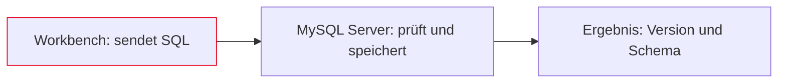
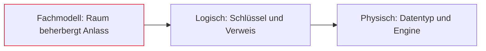
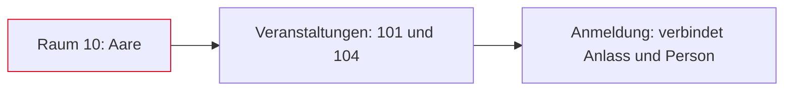
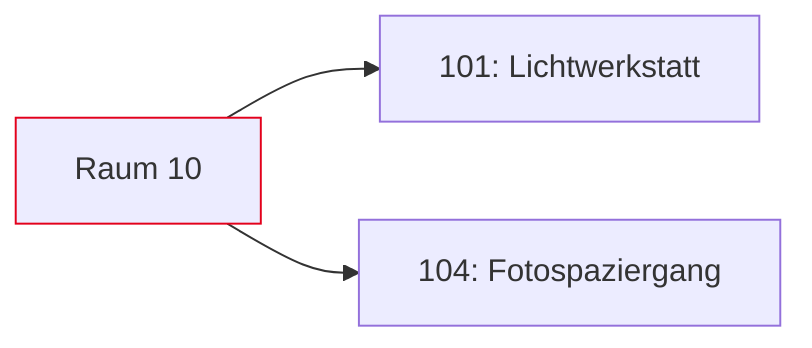
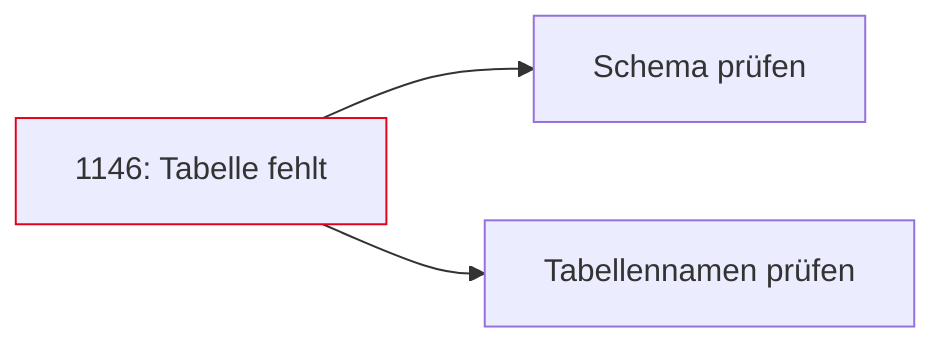

# Datenbanken und Datenmodelle

**Session 01.** Der Kursraum Aare ist in der EventStar-Liste sichtbar. Die Veranstaltungsplanung möchte wissen, wo seine Kapazität festgelegt ist und ob der Raum zwei Anlässe gleichzeitig aufnehmen könnte.

**Start.** Installieren Sie MySQL 8.4 oder MariaDB 11.4 LTS. Verbinden Sie MySQL Workbench mit dem gewählten Server und führen Sie [Session 01 EventStar.sql](Session%2001%20EventStar.sql) einmal aus.

### Lernziele

Sie können:

- **Verstehen:** Fachmodell, logisches Modell und physisches Modell am Raum erklären.
- **Verstehen:** Die Raumbeziehung in beide Richtungen lesen.
- **Anwenden:** Workbench verbinden und die MySQL-Version abfragen.
- **Analysieren:** Speicher-Engines anhand von Quellen und Rollback vergleichen.
- **Beurteilen:** Eine Verbesserung für eine ungeschützte Fachregel begründen.

## MySQL-Umgebung

### Datenbanken und SQL

Ein Datenbankmanagementsystem verwaltet Daten, gleichzeitige Zugriffe und Regeln. MySQL ist das System, EventStar ist der Datenbestand und Workbench ist ein Client. In einer relationalen Tabelle beschreibt eine Zeile einen einzelnen Sachverhalt und eine Spalte ein Merkmal. In `raeume` bezeichnet `raum_id` einen Raum eindeutig; eine Veranstaltung verweist mit derselben Nummer darauf.

SQL-Befehle lassen sich nach Aufgabe gruppieren. Die Kürzel helfen beim Einordnen; die Grenzen, insbesondere um SELECT, sind je nach Lehrbuch verschieden.

| Aufgabe | Beispiele |
|---|---|
| Struktur definieren (DDL) | CREATE TABLE, ALTER TABLE |
| Daten ändern (DML) | INSERT, UPDATE, DELETE |
| Daten abfragen (DQL) | SELECT |
| Rechte vergeben (DCL) | GRANT, REVOKE |
| Transaktionen steuern (TCL) | START TRANSACTION, COMMIT, ROLLBACK |

### MySQL und MariaDB

MySQL entstand 1995; die Entwicklung und Vermarktung wurden von MySQL AB getragen. Sun Microsystems übernahm MySQL AB 2008. Oracle schloss die Übernahme von Sun 2010 ab. Michael «Monty» Widenius, einer der MySQL-Gründer, initiierte 2009 den MariaDB-Fork. MySQL Community Server ist unter der GPL verfügbar; Oracle bietet daneben kommerzielle Lizenzen.

MariaDB und MySQL haben gemeinsame Wurzeln, aber eigene Releases. Beispielsweise hat MySQL einen nativen JSON-Typ, während MariaDB JSON als Alias für LONGTEXT implementiert. Daher prüfen Sie vor einer Migration Typen, Funktionen und SQL-Syntax. MySQL 8.0 und 8.4 sind unterschiedliche Versionsreihen; 8.4 ist ein Long-Term-Support-Zweig (LTS) und die Referenz für diesen Kurs. Prüfen Sie den tatsächlichen Server mit `SELECT VERSION()`.

**Quellen:** [MySQL-Geschichte](https://dev.mysql.com/doc/refman/8.4/en/history.html), [Oracle und Sun](https://www.oracle.com/corporate/acquisitions/sun/), [MariaDB Foundation](https://mariadb.org/about/), [MariaDB JSON](https://mariadb.com/kb/en/json-data-type/), [MySQL-Lizenzen](https://www.mysql.com/about/legal/licensing/), [MySQL-Releasemodell](https://dev.mysql.com/doc/refman/8.4/en/mysql-releases.html).

### Installation und Verbindung

Installieren Sie **einen** Server: MySQL 8.4 oder MariaDB 11.4 LTS. Die Kursbeispiele und die angegebenen Fehlermeldungen verwenden MySQL 8.4 als Referenz.

| System | MySQL 8.4 | MariaDB 11.4 LTS |
|---|---|---|
| Windows | [MySQL MSI](https://dev.mysql.com/downloads/mysql/) installieren und MySQL Configurator starten. TCP-Port 3306, lokales Administratorkonto und Windows-Dienst konfigurieren. | [MariaDB MSI](https://mariadb.org/download/) installieren. Datenbankinstanz, lokales Administratorkonto, TCP-Port 3306 und Windows-Dienst konfigurieren. |
| macOS | Passendes [MySQL-DMG](https://dev.mysql.com/downloads/mysql/) für die Prozessorarchitektur installieren. Server in den MySQL-Systemeinstellungen starten. | Mit [Homebrew](https://formulae.brew.sh/formula/mariadb@11.4) `brew install mariadb@11.4` und `brew services start mariadb@11.4` ausführen. Der lokale Client liegt unter `$(brew --prefix mariadb@11.4)/bin/mariadb`. |

Im Kurs arbeiten wir mit [MySQL Workbench](https://dev.mysql.com/downloads/workbench/); andere Clients sind frei wählbar, der Support ist eventuell eingeschränkt.

Bei TCP ist die Adresse `127.0.0.1`, Port 3306 und das beim Einrichten konfigurierte Konto vorgesehen. Falls der Administrator nur über den lokalen Socket anmelden kann, melden Sie sich zuerst dort mit dem Kommandozeilenclient an und richten ein lokales Kurskonto ein. Betreiben Sie nicht beide Server gleichzeitig auf demselben Port.

**Was prüfe ich?** Testen Sie im SQL-Editor `SELECT VERSION();`. Die Antwort identifiziert den Server, nicht den Client.

Bei der Kursversionsabfrage ergibt der Ausdruck `VERSION() LIKE '8.4.%'` für MySQL 8.4 den Wert 1 und für MariaDB den Wert 0. Das bedeutet bei MariaDB nicht, dass die Verbindung fehlgeschlagen ist. Mit MariaDB 11.4.13 wurden die EventStar-Startskripte und der Rollback-Versuch geprüft: InnoDB ist Standard, InnoDB nimmt die Zeile zurück, MyISAM nicht (Warnung 1196). Die Liste der Engines unterscheidet sich; MariaDB zeigt in der Testinstanz beispielsweise Aria. Recherchieren Sie für die Vergleichstabelle weiterhin gezielt MySQL 8.4. MySQL-spezifische Meldungen und der Workbench-Assistent beziehen sich auf die Referenzumgebung.

### Server und Client

Workbench sendet Ihre Anweisung. Die Antwort kommt vom Server. Prüfen Sie zuerst, ob Sie mit der vorgesehenen Version und dem Kursbestand arbeiten.



```sql
SELECT VERSION() LIKE '8.4.%' AS kursversion,
       DATABASE() AS aktives_schema;
```

| Kursversion | Aktives Schema |
| --- | --- |
| 1 | eventstar_01 |

**Was prüfe ich?** Bei NULL wurde kein Standardschema gewählt. Wählen Sie eventstar_01 in Workbench oder führen Sie USE eventstar_01 aus.

## Datenmodelle

### Modellstufen

Konzeptionell: Ein Raum kann Anlässe beherbergen. Logisch: Der Raum hat Nummer, Namen und Kapazität; die Veranstaltung referenziert seine Nummer. Das logische Modell legt noch keine MySQL-Typen fest.



```sql
SELECT raum_id, name, kapazitaet
FROM raeume WHERE raum_id = 10;
```

| Raum-ID | Name | Kapazität |
| --- | --- | --- |
| 10 | Aare | 36 |

**Was prüfe ich?** Der Name ist lesbar. Die Nummer identifiziert den Raum auch dann, wenn der Name geändert wird.

### Physisches Modell

Die MySQL-Definition ergänzt Typen, Zeichensatz, Engine und Prüfvorgaben. Lesen Sie zuerst die Schlüsselspalte; die vollständige Definition sehen Sie mit SHOW CREATE TABLE raeume.


```sql
SELECT COLUMN_TYPE, COLUMN_KEY
FROM INFORMATION_SCHEMA.COLUMNS
WHERE TABLE_SCHEMA = DATABASE() AND TABLE_NAME = 'raeume'
  AND COLUMN_NAME = 'raum_id';
```

| Spaltentyp | Schlüssel |
| --- | --- |
| smallint unsigned | PRI |

**Was prüfe ich?** PRI signalisiert den Primärschlüssel. UNSIGNED bedeutet, dass die physische Spalte keine negativen Werte speichert.

### Raum und Anlass

Im Modell steht der Verweis auf der Seite mit vielen Zeilen. Lesen Sie die Beziehung in beide Richtungen: Ein Raum kann mehrere Anlässe haben; jeder Anlass hat genau einen Raum.





```sql
SELECT veranstaltungs_id, titel
FROM veranstaltungen WHERE raum_id = 10
ORDER BY veranstaltungs_id;
```

| Anlass | Titel |
| --- | --- |
| 101 | Lichtwerkstatt |
| 104 | Fotospaziergang |

**Was prüfe ich?** Die Abfrage belegt zwei Zuordnungen, nicht ihre zeitliche Verträglichkeit. Für eine Raumplanung wären Anfang und Ende nötig; private Personendaten braucht dieser Abgleich nicht.

### Fehler 1146

Probieren Sie diese absichtlich falsche Anweisung einzeln. Die Tabelle heisst im logischen Modell Raum, im Server aber raeume.

```sql
SELECT raum_id FROM raum;
```

```text
ERROR 1146: Table 'eventstar_01.raum' doesn't exist
```



**Was prüfe ich?** 1146 nennt die nicht gefundene Tabelle samt Schema. Prüfen Sie zuerst das aktive Schema und die Liste links in Workbench. Bei einer unterbrochenen Verbindung ist dagegen noch keine SQL-Anweisung gestartet.

## Speicher und Transaktionen

### Transaktion

Eine Transaktion fasst mehrere Änderungen zu einer Einheit zusammen. EventStar schreibt eine Buchung und verringert die Zahl der **freien Plätze** um eins; die feste Raumkapazität bleibt gleich. Beide Änderungen müssen zusammen gelten.

| ACID-Eigenschaft | Beispiel bei EventStar |
|---|---|
| Atomarität | Scheitert die Buchung, wird auch die Änderung der freien Plätze zurückgenommen. |
| Konsistenz | Das Ergebnis hält die definierten Regeln ein, etwa eine nichtnegative Platzzahl und gültige Fremdschlüssel. Fachregeln müssen dazu im Schema oder im Buchungsablauf umgesetzt sein. |
| Isolation | Zwei gleichzeitige Buchungen dürfen nicht beide denselben letzten freien Platz erhalten. Dazu muss die Anwendung den Platz beispielsweise per bedingtem UPDATE oder sperrender Abfrage sichern. |
| Dauerhaftigkeit | Nach einem erfolgreichen COMMIT bleibt die Buchung bei der üblichen dauerhaften InnoDB-Konfiguration auch nach einem Neustart bestehen. |

`START TRANSACTION` beginnt den Block. `COMMIT` bestätigt ihn; `ROLLBACK` nimmt noch nicht bestätigte Änderungen an transaktionsfähigen Tabellen zurück. MySQL startet standardmässig mit Autocommit: Ohne expliziten Block wird jede erfolgreiche Anweisung einzeln bestätigt. Ein späteres ROLLBACK kann sie dann nicht zurücknehmen. Auch ein einzelner Fehler rollt in MySQL nicht zwingend den gesamten Block zurück; nehmen Sie einen abgebrochenen Arbeitsablauf ausdrücklich zurück.

**Was prüfe ich?** Vergleichen Sie im Engine-Versuch denselben INSERT vor und nach ROLLBACK. InnoDB nimmt ihn zurück, MyISAM nicht. Die Wahl der Engine entscheidet deshalb mit, ob beide EventStar-Änderungen als Einheit behandelt werden können.

### Engine-Vergleich

Die Speicher-Engine gehört zum physischen Modell. Sie bestimmt, wie MySQL eine Tabelle speichert und welche Funktionen sie unterstützt.

| Engine | Transaktionen | Fremdschlüssel | Sperren | Nach Absturz | Daten liegen | Typischer Einsatz |
|---|---|---|---|---|---|---|
| InnoDB (Standard) | Ja | Ja | Zeile | Automatisch | Auf Disk | EventStar |
| MyISAM | Nein | Nein | Tabelle | Reparatur; Verlust möglich | Auf Disk | Altsysteme |
| MEMORY | Nein | Nein | Tabelle | Leer nach Neustart | Im RAM | Temporäre Daten |
| CSV | Nein | Nein | Tabelle | Reparatur möglich | CSV-Datei | Austausch |
| ARCHIVE | Nein | Nein | Zeile | Reparatur möglich | Auf Disk | Protokolle |
| BLACKHOLE | Nein | Nein | Tabelle | Keine Zeilen | Nirgends | Replikation, Tests |

InnoDB stellt Daten nach einem Absturz automatisch wieder her. Unter den sechs Engines unterstützt nur InnoDB sowohl `ROLLBACK` als auch Fremdschlüssel. Deshalb passt der MySQL-Standard zu EventStar. MEMORY verliert seine Zeilen auch bei einem regulären Neustart. CSV unterstützt keine Indizes und verlangt `NOT NULL` für alle Spalten. ARCHIVE speichert Zeilen komprimiert und eignet sich für Protokolle, die per `INSERT` erfasst und per `SELECT` gelesen werden.

### SHOW ENGINES

```sql
SHOW ENGINES;
```

Ausgabe von MySQL 8.4.13, ohne die beschreibende Spalte `Comment`:

| Engine | Support | Transactions | XA | Savepoints |
|---|---|---|---|---|
| ndbcluster | NO | NULL | NULL | NULL |
| MEMORY | YES | NO | NO | NO |
| InnoDB | DEFAULT | YES | YES | YES |
| PERFORMANCE_SCHEMA | YES | NO | NO | NO |
| MyISAM | YES | NO | NO | NO |
| FEDERATED | NO | NULL | NULL | NULL |
| ndbinfo | NO | NULL | NULL | NULL |
| MRG_MYISAM | YES | NO | NO | NO |
| BLACKHOLE | YES | NO | NO | NO |
| CSV | YES | NO | NO | NO |
| ARCHIVE | YES | NO | NO | NO |

`Engine` nennt den Namen. Unter `Support` bedeutet `DEFAULT`: verfügbar und als Standard gesetzt; `YES`: verfügbar; `NO`: nicht verfügbar. `Transactions` zeigt die Transaktionsunterstützung, `XA` die Unterstützung verteilter Transaktionen und `Savepoints` die Unterstützung von Rücksetzpunkten innerhalb einer Transaktion. `NULL` bedeutet hier, dass für die nicht verfügbare Engine keine Angabe vorliegt.

**Was prüfe ich?** Lesen Sie die Zeile von InnoDB und vergleichen Sie die Ausgabe mit Ihrem eigenen Server. Engines und Standard können abweichen. Führen Sie den Rollback-Versuch im [Arbeitsblatt](Session%2001%20Arbeitsblatt.docx) durch.

**Quellen:** MySQL-8.4-Handbuch: [Speicher-Engines](https://dev.mysql.com/doc/refman/8.4/en/storage-engines.html), [SHOW ENGINES](https://dev.mysql.com/doc/refman/8.4/en/show-engines.html), [Tabellenreparatur](https://dev.mysql.com/doc/refman/8.4/en/repair-table.html), [CSV-Einschränkungen](https://dev.mysql.com/doc/refman/8.4/en/se-csv-limitations.html).

### Browser-Übung

Öffnen Sie [DB Fiddle](https://www.db-fiddle.com/) und wählen Sie eine angebotene MySQL-8-Version. Der Editor ist leer. Kopieren Sie das Startschema in «Schema SQL» und die Abfrage in «Query SQL».

<details>
<summary>Startschema für den Browser</summary>

```sql
CREATE TABLE raeume (raum_id SMALLINT UNSIGNED PRIMARY KEY, name VARCHAR(30));
INSERT INTO raeume VALUES (10, 'Aare');
```

</details>

```sql
SELECT raum_id, name FROM raeume;
```

### Selbstcheck

<details>
<summary>Welche Modellstufe legt InnoDB fest?</summary>

Das physische Modell. Im logischen Modell genügt die Beziehung mit ihren Schlüsseln.

</details>

<details>
<summary>Warum verhindert der Fremdschlüssel keine Doppelbelegung?</summary>

Er prüft den Raumverweis, nicht die zeitliche Überlappung.

</details>

<details>
<summary>Welche Aufgabe haben MySQL Workbench und der Datenbankserver?</summary>

Workbench sendet SQL und zeigt Ergebnisse. Der Server führt SQL aus, speichert Daten und prüft Regeln.

</details>

<details>
<summary>Was bleibt nach INSERT und ROLLBACK in InnoDB und MyISAM?</summary>

InnoDB nimmt den INSERT zurück. MyISAM unterstützt keine Transaktionen; die Zeile bleibt.

</details>

<details>
<summary>Was bedeuten DEFAULT, YES und NO in der Spalte Support von SHOW ENGINES?</summary>

DEFAULT: verfügbar und als Standard gesetzt. YES: verfügbar. NO: nicht verfügbar.

</details>

### Transfer

**Basis:** Markieren Sie im Arbeitsblatt zuerst den Raum und seinen Schlüssel. **Vertiefung:** Verfolgen Sie die Verbindung von Raum 10 zu einer Person und begründen Sie, welche Angaben eine Belegungsprüfung benötigt.

[Arbeitsblatt zum Ausfüllen](Session%2001%20Arbeitsblatt.docx)

### Freiwillige Übungen

[Übungen zu dieser Session](Session%2001%20%C3%9Cbungen.md).

## Zum Schmunzeln

Im Abschnitt «SQL» liest `SELECT` einen Wert, den `INSERT` anschliessend speichert. Wie Sie dieses Prinzip für echte Daten nutzen, zeigen [Session 05](../Session%2005/Session%2005%20Theorie.md) und [Session 07](../Session%2007/Session%2007%20Theorie.md).

*Quelle: Überlieferte Usenet-Witzliste; Urheberschaft der Bildfassung unbekannt.*


