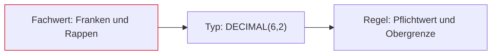
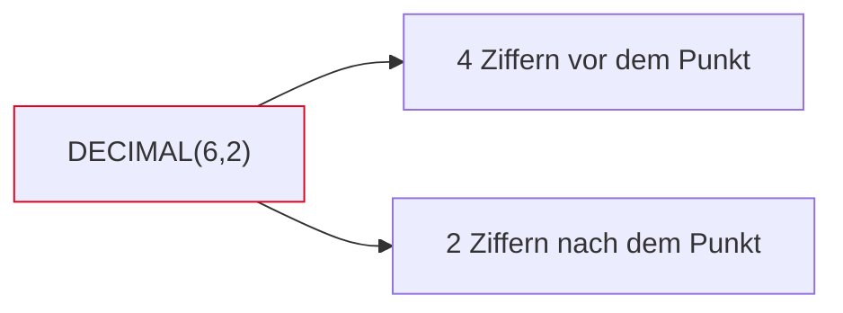
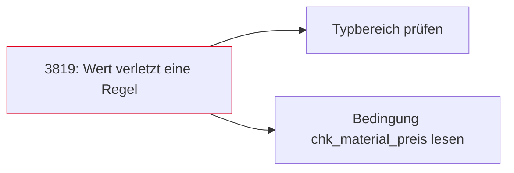
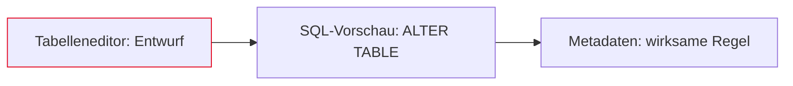

# Tabellen und Datentypen

**Session 02.** EventStar braucht eine Tabelle für Materialangebote. Beträge müssen auf Rappen stimmen; ein ungültiger Betrag soll gar nicht erst gespeichert werden.

**Start.** Öffnen Sie die Teams-Besprechung im Modulkanal. Laden Sie lokal in Workbench [Session 02 EventStar.sql](Session%2002%20EventStar.sql). Die neue Tabelle ist nur für den Versuch; sie wird am Schluss entfernt.

### Lernziele

Sie können:

- **Verstehen:** Schema, Tabelle und Spalte sowie Zeichensatz und Kollation unterscheiden.
- **Anwenden:** Für einen Fachwert einen passenden Typ und Wertebereich bestimmen.
- **Anwenden:** Dieselbe Tabelle in Workbench und SQL erstellen.
- **Analysieren:** Tabellenregeln in den Serverdefinitionen vergleichen.

## Schema und Tabellen

### Schema und Spalten

Ein Schema bündelt Tabellen; eine Tabelle bündelt gleichartige Zeilen. Der Server verwaltet Struktur und Daten. Workbench zeigt die Struktur und erzeugt auf Wunsch SQL.


```sql
SELECT TABLE_NAME, COLUMN_NAME, COLUMN_TYPE
FROM INFORMATION_SCHEMA.COLUMNS
WHERE TABLE_SCHEMA = DATABASE() AND TABLE_NAME = 'veranstaltungen'
  AND COLUMN_NAME = 'preis';
```

| Tabelle | Spalte | Typ |
| --- | --- | --- |
| veranstaltungen | preis | decimal(7,2) |

**Was prüfe ich?** DECIMAL(7,2) hat insgesamt sieben Ziffern, zwei davon nach dem Dezimalpunkt. FLOAT wäre für exakte Geldbeträge ungeeignet.

## Tabellendefinition und Typen

### Aufbau von CREATE TABLE

Nach `CREATE TABLE` steht der Tabellenname. Die Klammer enthält eine durch Kommas getrennte Liste aus Spaltendefinitionen und Tabellenregeln. Jede Spalte beginnt mit Name und Typ; danach folgen Attribute wie `NOT NULL` und `DEFAULT`. Vergleichen Sie die Definition mit dem Versuch für `material_test`:

| Bestandteil | Beispiel | Aufgabe |
|---|---|---|
| Tabellenname | `material_test` | Objekt im aktiven Schema |
| Spalte und Typ | `preis DECIMAL(6,2)` | Vier Stellen vor und zwei nach dem Punkt |
| Spaltenattribute | `NOT NULL DEFAULT 0.00` | Pflichtwert mit Vorgabe |
| Tabellenregel | `CONSTRAINT chk_material_preis CHECK (preis >= 0)` | Benannte Fachregel |
| Optionen nach der Klammer | `ENGINE=InnoDB DEFAULT CHARACTER SET=utf8mb4` | Speicher-Engine und Standardzeichensatz |

Eine Regel auf Spaltenebene steht bei der Spalte. Eine Tabellenregel steht als eigener Listeneintrag und kann mehrere Spalten kombinieren, etwa `UNIQUE (raum_id, beginn)` oder `CHECK (ende > beginn)`. Schreiben Sie Fremdschlüssel in MySQL als eigenen `FOREIGN KEY (...) REFERENCES ...`-Eintrag; verlassen Sie sich nicht auf ein blosses `REFERENCES` hinter dem Spaltentyp. Mit `CONSTRAINT name` lassen sich etwa CHECK und FOREIGN KEY benennen. Ein expliziter Name hilft, eine Fehlermeldung der richtigen Regel zuzuordnen. `DESCRIBE` zeigt eine Kurzliste der Spalten; `SHOW CREATE TABLE` zeigt die vollständige vom Server gespeicherte Definition.

### MySQL-Datentypen

Wählen Sie den Typ nach Wertebereich, Genauigkeit und Verwendungszweck, nicht nach der Darstellung in Workbench.

| Ganzzahltyp | Mit Vorzeichen | UNSIGNED |
|---|---|---|
| TINYINT | −128 bis 127 | 0 bis 255 |
| SMALLINT | −32’768 bis 32’767 | 0 bis 65’535 |
| MEDIUMINT | −8’388’608 bis 8’388’607 | 0 bis 16’777’215 |
| INT | −2’147’483’648 bis 2’147’483’647 | 0 bis 4’294’967’295 |
| BIGINT | −2^63 bis 2^63−1 | 0 bis 2^64−1 |

Für höchstens 1’500 Plätze passt `SMALLINT UNSIGNED`. Null bleibt damit möglich; eine Mindestkapazität von 1 benötigt eine zusätzliche Regel.

| Typfamilie | EventStar-Entscheid |
|---|---|
| DECIMAL(p,s) | Exakte Dezimalzahl, etwa `DECIMAL(6,2)` für Preise bis 9’999.99 Franken. |
| FLOAT, DOUBLE | Näherungswerte für Messungen; DOUBLE bietet höhere Genauigkeit. Nicht für Geld. |
| CHAR, VARCHAR, TEXT | CHAR(4) für festen Code, VARCHAR(80) für Namen, TEXT für längere Beschreibungen. CHAR garantiert nicht die fachliche Mindestlänge. |
| DATE, TIME | Kalendertag oder Uhrzeit. MySQL TIME kann auch Dauern abbilden; für ganze Minuten genügt oft eine Ganzzahl. |
| DATETIME, TIMESTAMP | DATETIME für lokale Anlasszeit ohne Umrechnung; TIMESTAMP für Zeitpunkte mit Umrechnung zwischen Sitzungszeitzone und UTC. TIMESTAMP hat in MySQL 8.4 einen begrenzteren Wertebereich als DATETIME. |
| BOOLEAN | Alias für TINYINT(1); TRUE ist 1, FALSE ist 0. Für ausschliesslich 0 und 1 zusätzlich CHECK verwenden. |
| ENUM | Kleine, stabile Werteliste, etwa Materialzustand. Ändert sich die Liste häufig oder hat sie weitere Daten, ist eine eigene Tabelle zweckmässiger. |
| JSON, BLOB | JSON prüft die JSON-Struktur, etwa bei Importmetadaten. BLOB speichert Bytes, etwa einen kleinen binären Anhang. |

### Preisregeln

Ein Datentyp bestimmt, wie ein Wert dargestellt wird, aber nicht immer, ob er fachlich gültig ist. Ein negativer Preis passt in DECIMAL(6,2). Erst die CHECK-Regel weist ihn auch bei einem Import oder einer Eingabe ausserhalb von Workbench ab.

| Preis | DECIMAL(6,2) | CHECK ab 0 |
| --- | --- | --- |
| 12.50 | Passt | Zulässig |
| -0.50 | Passt | Abgelehnt |

**Was prüfe ich?** Sagen Sie vor dem Gegenversuch voraus, welche Regel den negativen Wert zurückweist.

### Datentypen und Regeln

Der Schlüssel identifiziert das Angebot. Der Titel ist Pflicht. Der Preis ist exakt, standardmässig null Franken und darf nicht negativ werden. Führen Sie CREATE aus und vergleichen Sie in Workbench die Tabelle mit Ihrer Vorhersage.





```sql
DROP TABLE IF EXISTS material_test;
CREATE TABLE material_test (
    angebot_id INT UNSIGNED PRIMARY KEY,
    titel VARCHAR(60) NOT NULL,
    preis DECIMAL(6,2) NOT NULL DEFAULT 0.00,
    CONSTRAINT chk_material_preis CHECK (preis BETWEEN 0 AND 9999.99)
) ENGINE=InnoDB;
INSERT INTO material_test (angebot_id, titel) VALUES (1, 'Papier');
SELECT angebot_id, titel, preis FROM material_test;
```

| Angebot | Titel | Preis |
| --- | --- | --- |
| 1 | Papier | 0.00 |

**Was prüfe ich?** CREATE TABLE definiert die Struktur; INSERT fügt Daten hinzu; SELECT liest sie. DEFAULT greift hier, weil preis im INSERT fehlt.

## Constraints und Schlüssel

### Constraints und Spaltenattribute

| Regel oder Attribut | Wirkung |
|---|---|
| NOT NULL | Kein NULL. Leerer Text ist nicht NULL. |
| UNIQUE | Keine doppelten Schlüsselwerte; MySQL lässt mehrere NULL in einem UNIQUE-Index zu. |
| CHECK | Prüft einen Ausdruck pro Zeile. FALSE wird abgewiesen; UNKNOWN durch NULL nicht. Bei Pflichtfeldern zusätzlich NOT NULL. MySQL setzt CHECK seit 8.0.16 durch; ein Verstoss ergibt Fehler 3819. |
| DEFAULT | Vorgabewert, wenn die Spalte beim INSERT ausgelassen oder DEFAULT benutzt wird. Verbietet NULL nicht selbst. |
| AUTO_INCREMENT | Vergibt eine Nummer bei der Einfügung. Kein Ersatz für PRIMARY KEY oder UNIQUE; Nummern können Lücken haben. |

### Spezialfall Primärschlüssel

Für eine Pflichtangabe mit fester Zeichenanzahl prüfen Sie beides separat: NOT NULL und zum Beispiel CHECK (CHAR_LENGTH(farbcode) = 6). CHAR(6) allein prüft die Mindestlänge nicht. Bei NOT NULL bleibt zudem eine leere Zeichenkette erlaubt; CHECK (CHAR_LENGTH(TRIM(farbcode)) > 0) schliesst auch nur aus Leerzeichen bestehende Eingaben aus.

Der PRIMARY KEY identifiziert eine Zeile. Seine Spalten sind eindeutig als Kombination und dürfen einzeln nicht NULL sein. Je Tabelle gibt es höchstens einen Primärschlüssel; er kann aus mehreren Spalten bestehen. Ein Paar (Raum, Tag) identifiziert beispielsweise eine Tagesbelegung, auch wenn derselbe Raum an mehreren Tagen in der Tabelle steht.

### Spezialfall Fremdschlüssel

Der FOREIGN KEY prüft, ob der referenzierte Schlüssel in der Elterntabelle existiert. Gleiche Integer-Typen und gleiches Vorzeichen sind wichtig. Verwenden Sie in diesem Kurs InnoDB für beide Tabellen und referenzieren Sie einen PRIMARY KEY oder UNIQUE-Schlüssel. Ohne passenden Elternschlüssel meldet MySQL Fehler 1452. Ein NULL-Wert in einer optionalen Fremdschlüsselspalte verlangt keinen Treffer; Pflichtbeziehungen benötigen NOT NULL. Mit ON UPDATE und ON DELETE legen Sie die Wirkung von Änderungen an der Elternzeile fest. [Session 03](../Session%2003/Session%2003%20Theorie.md) vertieft Beziehungen, Session 04 die Referenzaktionen.

Führen Sie den Aufbau einmal in einem leeren Übungsschema aus. Führen Sie die drei Gegenproben einzeln aus.

```sql
CREATE TABLE material_raum (
    id SMALLINT UNSIGNED PRIMARY KEY
) ENGINE=InnoDB;
CREATE TABLE material_fenster (
    raum_id SMALLINT UNSIGNED NOT NULL,
    tag DATE NOT NULL,
    preis DECIMAL(6,2) NOT NULL DEFAULT 0.00,
    PRIMARY KEY (raum_id, tag),
    CONSTRAINT fk_material_raum FOREIGN KEY (raum_id)
        REFERENCES material_raum (id),
    CONSTRAINT chk_material_fenster CHECK (preis >= 0)
) ENGINE=InnoDB DEFAULT CHARACTER SET=utf8mb4;
INSERT INTO material_raum VALUES (10);
INSERT INTO material_fenster (raum_id, tag)
VALUES (10, '2026-11-26');
```

```sql
SELECT * FROM material_fenster;
DESCRIBE material_fenster;
SHOW CREATE TABLE material_fenster;
```

Die erste Abfrage ergibt Raum 10, 2026-11-26 und 0.00. DESCRIBE zeigt beide Schlüsselspalten als PRI; SHOW CREATE TABLE zeigt zusätzlich die Namen der Regeln.

```sql
INSERT INTO material_fenster VALUES (10, '2026-11-26', 12.50);
```

`ERROR 1062: Duplicate entry '10-2026-11-26' for key 'material_fenster.PRIMARY'`

```sql
INSERT INTO material_fenster VALUES (99, '2026-11-27', 12.50);
```

`ERROR 1452: Cannot add or update a child row: a foreign key constraint fails` (der Server nennt danach `fk_material_raum`).

```sql
INSERT INTO material_fenster VALUES (10, '2026-11-27', -0.50);
```

`ERROR 3819: Check constraint 'chk_material_fenster' is violated.`

**Was prüfe ich?** Das Paar ist bereits belegt, Raum 99 fehlt und der negative Preis verletzt die Fachregel. Jede Gegenprobe prüft nur eine Regel.

```sql
DROP TABLE material_fenster, material_raum;
```

### Fehler 3819

Sagen Sie vor dem Ausführen voraus, welche Regel verletzt wird. Führen Sie nur die folgende Anweisung aus.

```sql
INSERT INTO material_test VALUES (2, 'Karton', -0.50);
```

```text
ERROR 3819: Check constraint 'chk_material_preis' is violated
```



**Was prüfe ich?** 3819 nennt chk_material_preis. Der Betrag passt in den Typ, scheitert jedoch an der Fachregel. NOT NULL schützt vor fehlenden, nicht vor negativen Beträgen.

### Tabellenänderung

Ein Lagerort kann fehlen. Ergänzen Sie die Spalte und kontrollieren Sie, dass bestehende Zeilen ohne Ort weiterhin zulässig sind. In Workbench können Sie denselben Änderungsbefehl vor Apply in der Vorschau lesen.



```sql
ALTER TABLE material_test ADD COLUMN lagerort VARCHAR(25) NULL;
SELECT angebot_id, lagerort FROM material_test;
DROP TABLE material_test;
```

| Angebot | Lagerort |
| --- | --- |
| 1 | NULL |

**Was prüfe ich?** Ein fehlender Ort ist NULL, nicht der Text «unbekannt». DROP entfernt die Versuchstabelle; bei Kurstabellen wechseln Sie vor dem Löschen bewusst ins Übungsschema.

## Vergleich und Praxis

### Unterschiede zwischen Datenbanksystemen

Die folgenden Angaben beziehen sich auf MySQL 8.4, PostgreSQL, SQL Server und Oracle Database 23ai. Die MySQL-Beispiele dieses Kurses lassen sich deshalb nicht unverändert übertragen.

| Thema | MySQL 8.4 | PostgreSQL | SQL Server | Oracle 23ai |
|---|---|---|---|---|
| Automatische Nummer | AUTO_INCREMENT | GENERATED AS IDENTITY; auch SERIAL | IDENTITY(1,1) | GENERATED AS IDENTITY; auch Sequenz |
| Zeichenketten | VARCHAR mit Zeichensatz | VARCHAR, TEXT | VARCHAR; NVARCHAR für Unicode unabhängig von UTF-8-Kollation | VARCHAR2, NVARCHAR2 |
| Wahrheitswert | BOOLEAN als TINYINT(1) | BOOLEAN | BIT | BOOLEAN in SQL seit 23ai |
| Datum und Zeit | DATE, DATETIME, TIMESTAMP | DATE, TIMESTAMP mit oder ohne Zeitzone | DATE, DATETIME2, DATETIMEOFFSET; TIMESTAMP ist ROWVERSION | DATE mit Uhrzeit, TIMESTAMP mit oder ohne Zeitzone |
| Exakter Betrag | DECIMAL(p,s) | NUMERIC(p,s) | DECIMAL(p,s) | NUMBER(p,s) |
| CHECK | Durchgesetzt seit 8.0.16; mit NOT ENFORCED deaktivierbar | Prüft neue Daten auch bei NOT VALID | Kann deaktiviert werden; WITH NOCHECK überspringt die Bestandsprüfung beim Anlegen | ENABLE VALIDATE prüft den Bestand; ENABLE NOVALIDATE prüft neue Änderungen |
| Bezeichner | Backticks; doppelte Anführungszeichen mit ANSI_QUOTES | Doppelte Anführungszeichen | Eckige Klammern; doppelte Anführungszeichen mit QUOTED_IDENTIFIER ON | Doppelte Anführungszeichen |
| Zeilenlimit | LIMIT 5 | LIMIT 5 oder FETCH FIRST 5 ROWS ONLY | TOP (5) oder OFFSET … FETCH NEXT | FETCH FIRST 5 ROWS ONLY |

Bei Zeilenlimits bestimmt erst ORDER BY, welche Zeilen zuerst kommen. Vergleichen Sie beim Umstieg nicht nur die Schreibweise, sondern auch die Bedeutung des Typs: SQL Server TIMESTAMP enthält keine Uhrzeit.

**Dokumentation:** [MySQL 8.4: CREATE TABLE](https://dev.mysql.com/doc/refman/8.4/en/create-table.html), [MySQL 8.4: Datentypen](https://dev.mysql.com/doc/refman/8.4/en/data-types.html), [PostgreSQL](https://www.postgresql.org/docs/current/sql-createtable.html), [SQL Server](https://learn.microsoft.com/en-us/sql/t-sql/statements/create-table-transact-sql), [Oracle Database 23ai](https://docs.oracle.com/en/database/oracle/oracle-database/23/sqlrf/CREATE-TABLE.html).

### Strukturänderungen und Indizes

Die temporäre Liste dient EventStar zur Kalibrierung seiner Lichttechnik. MySQL 8.4 verlangt bei DATE-Ausdrücken als Standardwert die Klammern. Der Tag wird bei der Einfügung bestimmt, wenn die Spalte ausgelassen wird. Eine vorhandene Spalte lässt sich mit RENAME COLUMN umbenennen, ohne ihren Typ anzugeben. DROP COLUMN löscht auch ihre Werte.

```sql
CREATE TEMPORARY TABLE theorie_lichtmessung (
    messung_id INT AUTO_INCREMENT PRIMARY KEY,
    inventarzeichen VARCHAR(12) NOT NULL UNIQUE,
    gemessen_am DATE NOT NULL DEFAULT (CURRENT_DATE),
    bemerkung VARCHAR(80)
);
INSERT INTO theorie_lichtmessung (inventarzeichen) VALUES ('LX-74');
ALTER TABLE theorie_lichtmessung RENAME COLUMN bemerkung TO techniknotiz;
ALTER TABLE theorie_lichtmessung DROP COLUMN techniknotiz;
CREATE INDEX ix_lichtmessung_tag ON theorie_lichtmessung (gemessen_am);
SHOW INDEX FROM theorie_lichtmessung;
EXPLAIN SELECT messung_id FROM theorie_lichtmessung WHERE gemessen_am = CURRENT_DATE;
SELECT gemessen_am = CURRENT_DATE AS tag_stimmt FROM theorie_lichtmessung;
DROP TEMPORARY TABLE theorie_lichtmessung;
```

**Resultat.** SHOW INDEX meldet PRIMARY, den eindeutigen Index für inventarzeichen und ix_lichtmessung_tag. In der Spalte Non_unique bedeutet 0 eindeutig, 1 nicht eindeutig. tag_stimmt ist 1.

Ein B-Baum leitet die Suche anhand geordneter Schlüssel über mehrere Ebenen. Ohne geeigneten Index muss MySQL gegebenenfalls die ganze Tabelle durchsuchen. InnoDB hält die Zeilendaten in den Blättern des gruppierten Index, hier des Primärschlüssels. Sekundärindizes enthalten den Primärschlüssel: Sind zusätzliche Spalten nötig, kann ein zweiter Zugriff über diesen Schlüssel folgen. Das bedeutet nicht zwei feste Festplattenzugriffe; Seiten können bereits im Speicher liegen. InnoDB erstellt bei Bedarf automatisch einen passenden Index auf den Fremdschlüsselspalten der Kindtabelle.

**Was prüfe ich?** Vergleichen Sie possible_keys (mögliche Indizes) mit key (gewählter Index). Bei wenigen Zeilen kann ein Scan trotz Index günstiger sein. Indizes belegen Platz und müssen bei Datenänderungen gepflegt werden.

### Trigger (Vertiefung)

Ein Trigger läuft pro betroffener Zeile. BEFORE kann einen NEW-Wert vor der Speicherung ändern; AFTER eignet sich für einen Folgeeintrag in einer anderen Tabelle. INSERT kennt nur NEW, DELETE nur OLD; UPDATE kennt beide. Vergleichen Sie bei einer Statusänderung OLD und NEW, damit eine unveränderte Zeile keine zweite Folgeaktion auslöst. Verwenden Sie für mehrere Anweisungen BEGIN und END; in Workbench oder im mysql-Client setzen Sie dann einen anderen DELIMITER, damit der Client die inneren Semikolons nicht als Befehlsende liest.

Die Änderung in diesem Beispiel entfernt äussere Leerzeichen aus einer Gerätebeschriftung. Trigger sind nicht auf temporären Tabellen zulässig.

```sql
CREATE TABLE theorie_beschriftung (name VARCHAR(40) NOT NULL);
CREATE TRIGGER theorie_beschriftung_bi BEFORE INSERT ON theorie_beschriftung
FOR EACH ROW SET NEW.name = TRIM(NEW.name);
INSERT INTO theorie_beschriftung VALUES ('  Lichtpult  ');
SELECT CHAR_LENGTH(name) AS laenge FROM theorie_beschriftung;
DROP TABLE theorie_beschriftung;
```

**Resultat.** Die Länge beträgt 9 statt 13. Das Löschen der Beispieltabelle entfernt auch ihren Trigger.

### Zeichensatz und Kollation

Zeichensatz bestimmt, welche Zeichen speicherbar sind; Kollation bestimmt, wie sie verglichen werden. InnoDB ist die Speicher-Engine. Ein Tablespace organisiert die Ablage; eine Partition unterteilt dagegen eine Tabelle nach einer Regel.


```sql
SELECT _utf8mb4'Aare' COLLATE utf8mb4_0900_ai_ci
       = _utf8mb4'aare' AS gleich;
```

| Gleich |
| --- |
| 1 |

**Was prüfe ich?** ci steht für Vergleich ohne Beachtung der Gross- und Kleinschreibung. Dieselben Zeichen können unter einer anderen Kollation anders verglichen werden.

### Browser-Übung

Öffnen Sie [DB Fiddle](https://www.db-fiddle.com/) und wählen Sie eine angebotene MySQL-8-Version. Der Editor ist leer. Kopieren Sie das Startschema in «Schema SQL» und die Abfrage in «Query SQL».

<details>
<summary>Startschema für den Browser</summary>

```sql
CREATE TABLE material (id INT PRIMARY KEY, preis DECIMAL(6,2) NOT NULL DEFAULT 0.00);
INSERT INTO material (id) VALUES (1);
```

</details>

```sql
SELECT * FROM material;
```

### Selbstcheck

<details>
<summary>Wann ist CHAR sinnvoller als VARCHAR?</summary>

Bei gleich langen Werten, etwa einem vierstelligen Code. Eine zusätzliche Regel kann die genaue Länge absichern.

</details>

<details>
<summary>Warum reicht ein Datentyp nicht für jede Fachregel?</summary>

DECIMAL speichert genaue Beträge, erlaubt aber auch negative Werte. CHECK schränkt den erlaubten Bereich ein.

</details>

### Transfer

**Basis:** Entwerfen Sie im Arbeitsblatt den vierstelligen Code, bevor Sie Typ und Regel für die Preise ergänzen. **Vertiefung:** Vergleichen Sie die Definition aus Workbench mit Ihrem SQL und erklären Sie jede Abweichung.

[Arbeitsblatt zum Ausfüllen](Session%2002%20Arbeitsblatt.docx)

### Freiwillige Übungen

[Übungen zu dieser Session](Session%2002%20%C3%9Cbungen.md).
