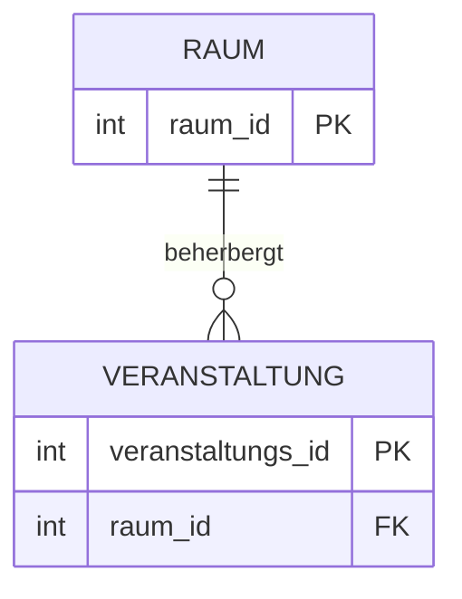
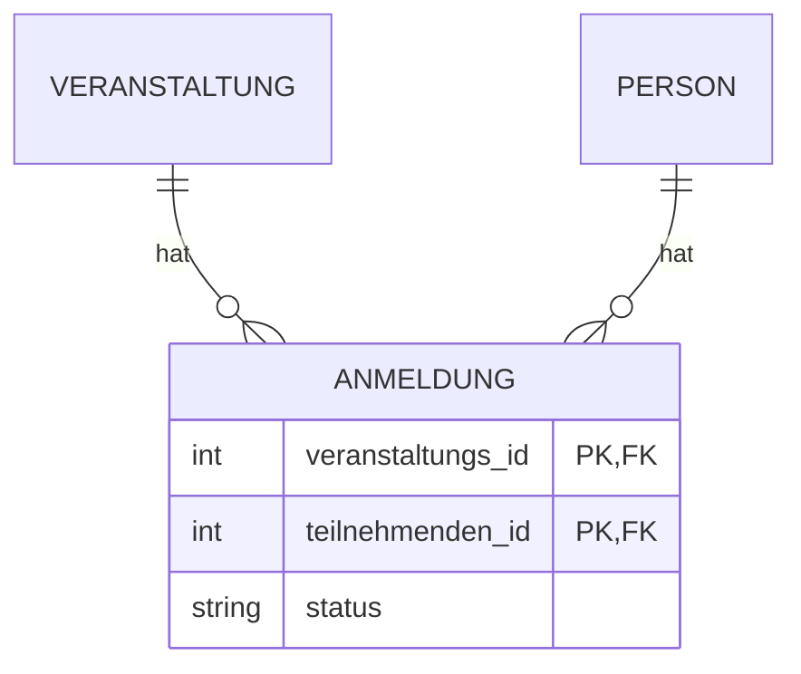
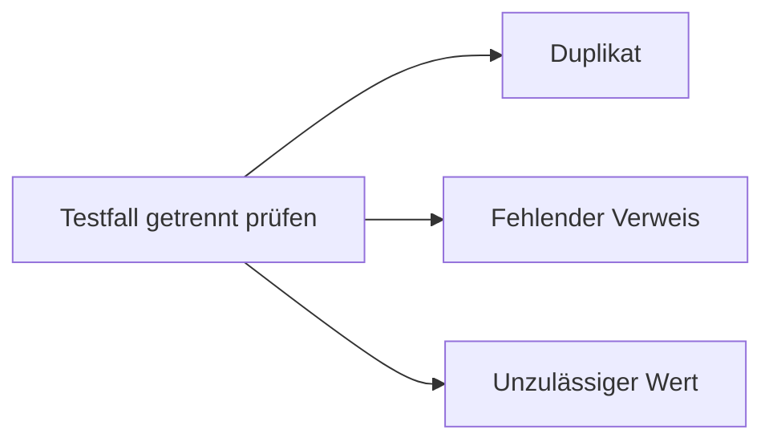
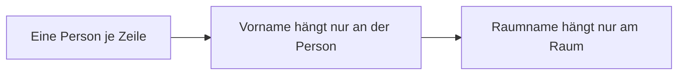
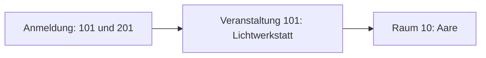

# Schlüssel, Beziehungen und Normalformen

EventStar führt eine Anmeldeliste für die Lichtwerkstatt. Bei einer Übernahme taucht dieselbe Person zweimal auf. Eine andere Zeile verweist auf einen Anlass, den es nicht gibt. Ausserdem steht der Raumname in jeder exportierten Zeile. Welche Regeln muss die Datenbank selbst sichern, und welche Daten gehören in eine andere Tabelle?

**Start in Workbench:** Öffnen Sie [Session 03 EventStar.sql](Session%2003%20EventStar.sql) und führen Sie die Datei einmal auf dem lokalen MySQL-8.4-Server aus. Die Schritte arbeiten mit dem Schema `eventstar_03`. Negative Testfälle bitte einzeln ausführen. Kein Versuch verändert den Ausgangsbestand dauerhaft.

### Lernziele

Sie können:

- **Verstehen:** Schlüssel, Kardinalität und Optionalität im Modell erklären.
- **Anwenden:** Eine Zwischentabelle und einen Selbstbezug modellieren.
- **Analysieren:** Serverfehler den verletzten Schlüssel- oder Wertregeln zuordnen.
- **Analysieren:** Einen Export nach seinen Abhängigkeiten bis zur dritten Normalform zerlegen.

## Beziehungen und Schlüssel

### Kardinalität

[Session 02](../Session%2002/Session%2002%20Theorie.md#spezialfall-primärschlüssel) führt Primär- und Fremdschlüssel in CREATE TABLE ein. Hier geht es darum, aus der Fachbeziehung die richtigen Schlüssel und Kardinalitäten abzuleiten.

In der Krähenfussnotation steht ein Kreis für optional (mindestens null), ein Strich für eins und der Krähenfuss für viele. Ein Raum hat null bis viele Veranstaltungen (eins zu viele); Veranstaltung und Person sind über die Anmeldung viele zu viele. Für eine Eins-zu-eins-Beziehung, etwa Raum und optionale Zutrittskonfiguration, muss der Fremdschlüssel auf der Konfigurationsseite zusätzlich eindeutig sein.

Eine Veranstaltung findet in genau einem Raum statt. Ein Raum kann ungeplant bleiben oder für mehrere Veranstaltungen belegt sein. Prüfen Sie Raum 10 am Server.



```sql
USE eventstar_03;
SELECT veranstaltungs_id, titel
FROM veranstaltungen
WHERE raum_id = 10
ORDER BY veranstaltungs_id;
```

| Nummer | Titel |
|---|---|
| 101 | Lichtwerkstatt |
| 104 | Fotospaziergang |

**Was prüfe ich?** Der Fremdschlüssel steht auf der Seite, auf der mehrere Zeilen auf denselben Raum verweisen dürfen. Zwei Treffer beschreiben den aktuellen Bestand, nicht die Obergrenze. Auch ohne Treffer bleibt ein Raum gültig.

### Zusammengesetzter Primärschlüssel

Person 201 ist für mehr als eine Veranstaltung angemeldet. Veranstaltung 101 hat mehr als eine angemeldete Person. Nur **beide Schlüssel zusammen** identifizieren eine Anmeldung. Die Anmeldung trägt den Status, nicht die Person.



```sql
SELECT teilnehmenden_id, status
FROM anmeldungen
WHERE veranstaltungs_id = 101
ORDER BY teilnehmenden_id;
```

| Person | Status |
|---|---|
| 201 | bezahlt |
| 202 | offen |
| 204 | storniert |

**Was prüfe ich?** In `SHOW CREATE TABLE anmeldungen` stehen beide Spalten im Primärschlüssel. Die beiden Verweise sind identifizierend, weil sie zur Identität der Anmeldung beitragen. Der Raumverweis dagegen identifiziert die Veranstaltung nicht.

**Ausprobieren:** Filtern Sie nach Person 201 statt nach Anlass 101. Prüfen Sie, welche Anlässe erscheinen.

### Selbstbezug

Für ON DELETE und ON UPDATE stehen in InnoDB unter anderem RESTRICT, NO ACTION (in InnoDB sofort wie RESTRICT), CASCADE und SET NULL zur Verfügung. SET NULL setzt eine nullable Kindspalte voraus. PostgreSQL kann NO ACTION bei einer entsprechend deklarierten Regel bis zum Transaktionsende aufschieben; das ist bei InnoDB nicht der Fall. [Session 04](../Session%2004/Session%2004%20Theorie.md) testet die Wirkungen mit EventStar.

Die EventStar-Einsatzleitung möchte sehen, an wen sich eine Person wenden kann. Dafür braucht es keine zweite Personentabelle: Die Spalte `vorgesetzten_id` verweist auf den Schlüssel derselben Tabelle.


```sql
SELECT name, vorgesetzten_id
FROM mitarbeitende
WHERE mitarbeitenden_id IN (1, 2)
ORDER BY mitarbeitenden_id;
```

| Person | Schlüssel der vorgesetzten Person |
|---|---|
| Lea Fluss | NULL |
| Miro Tal | 1 |

**Was prüfe ich?** `NULL` erlaubt «keine Leitung hinterlegt». Ein vorhandener Fremdschlüssel verhindert keinen Kreis. In Workbench lässt sich für diesen Selbstbezug dieselbe Tabelle als Quelle und Ziel auswählen. Gleicher Typ und gleiches Vorzeichen sind auch hier erforderlich.

## Datenregeln und Fehler

### Datenregeln

Eine zweite EventStar-Liste ordnet Gerätenummern ihren Prüfterminen zu. Die Liste erlaubt pro Gerät und Tag nur einen Prüftermin; bei der Dauer sind 5 bis 60 Minuten erlaubt. Der erste Eintrag verwendet die Standarddauer.



```sql
CREATE TABLE IF NOT EXISTS theorie_geraet (id INT PRIMARY KEY);
CREATE TABLE IF NOT EXISTS theorie_prueftermin (
    geraet_id INT, tag DATE,
    dauer_min INT NOT NULL DEFAULT 10,
    PRIMARY KEY (geraet_id, tag),
    FOREIGN KEY (geraet_id) REFERENCES theorie_geraet (id),
    CONSTRAINT chk_pruefdauer CHECK (dauer_min BETWEEN 5 AND 60)
);
INSERT IGNORE INTO theorie_geraet VALUES (71);
INSERT IGNORE INTO theorie_prueftermin (geraet_id, tag)
VALUES (71, '2027-03-02');
SELECT dauer_min FROM theorie_prueftermin
WHERE geraet_id = 71 AND tag = '2027-03-02';
```

| Dauer in Minuten |
|---|
| 10 |

> [!WARNING]
> Führen Sie die folgenden drei Anweisungen einzeln aus. Jede ist absichtlich ungültig. Der erste Fehler kann die weitere Skriptausführung im Client abbrechen.

```sql
INSERT INTO theorie_prueftermin VALUES (71, '2027-03-02', 15);
```

```sql
INSERT INTO theorie_prueftermin VALUES (83, '2027-03-02', 15);
```

```sql
INSERT INTO theorie_prueftermin VALUES (71, '2027-03-03', 90);
```

| Fehleranfang aus MySQL | Was prüfe ich? |
|---|---|
| ERROR 1062: Duplicate entry '71-2027-03-02' | Das Gerät ist an diesem Tag bereits eingetragen. |
| ERROR 1452: Cannot add or update a child row | Gerät 83 fehlt im Gerätebestand. |
| ERROR 3819: Check constraint 'chk_pruefdauer' is violated | 90 Minuten liegen ausserhalb des erlaubten Bereichs. |

In Workbench steht die Nummer im Bereich «Action Output». Der Wortlaut nach der Fehlernummer kann zusätzlich Schema, Tabelle und Regelnamen enthalten.

## Normalisierung

### Redundanz und Anomalien

EventStar plant die Anlässe 101 und 104 in Raum 10. Beide Anlasszeilen müssen auf Raum 10 verweisen. Den Namen «Aare» in beiden Zeilen zu speichern, ist dagegen **Redundanz**: Derselbe Sachverhalt ist mehrfach gespeichert. Das belegt mehr Speicher und kann beim Einfügen, Ändern oder Löschen zu falschen oder verlorenen Informationen führen.

Legen Sie in MySQL im Tab für `eventstar_03` eine temporäre Kopie an. Alle folgenden Befehle gehören in denselben Tab und ändern keine EventStar-Kurstabellen.

```sql
CREATE TEMPORARY TABLE export_probe (
    anlass_id INT PRIMARY KEY,
    raum_id INT NOT NULL,
    raumname VARCHAR(40) NOT NULL
);
INSERT INTO export_probe VALUES (101, 10, 'Aare'), (104, 10, 'Aare');
SELECT * FROM export_probe ORDER BY anlass_id;
```

| Anlass | Raum-ID | Raumname |
|---|---|---|
| 101 | 10 | **Aare** |
| 104 | 10 | **Aare** |

**Was prüfe ich?** Gleiche Raum-ID und gleicher Name bedeuten hier nicht zwei Räume. Wiederholt ist der Name; die beiden Zuordnungen zu Raum 10 sind unterschiedliche Fakten.

### Einfügeanomalie

EventStar eröffnet Raum 20 «Matte». Es gibt noch keinen Anlass dafür. Führen Sie den Einfügeversuch einzeln aus.

```sql
INSERT INTO export_probe (raum_id, raumname) VALUES (20, 'Matte');
```

MySQL weist den Versuch ab: `ERROR 1364: Field 'anlass_id' doesn't have a default value`. Die Tabelle bleibt unverändert:

| Anlass | Raum-ID | Raumname |
|---|---|---|
| 101 | 10 | Aare |
| 104 | 10 | Aare |

**Was prüfe ich?** Der Name «Matte» ist zulässig. Das Exportmodell verlangt aber eine Anlass-ID. Ein erfundener Anlass würde einen fachlich falschen Datensatz erzeugen.

### Änderungsanomalie

Raum 10 heisst neu «Aare Nord». Der folgende Befehl erwischt nur die Zeile von Anlass 101. Vergleichen Sie mit der vorherigen Tabelle.

```sql
UPDATE export_probe SET raumname = 'Aare Nord' WHERE anlass_id = 101;
SELECT * FROM export_probe ORDER BY anlass_id;
```

| Anlass | Raum-ID | Raumname nach dem UPDATE |
|---|---|---|
| 101 | 10 | **Aare Nord** |
| 104 | 10 | **Aare** |

**Was prüfe ich?** Die Namen zu Raum 10 widersprechen sich. Ein korrektes `WHERE raum_id = 10` könnte diesen Einzelfehler beheben, aber die Mehrfachspeicherung bliebe.

### Löschanomalie

Gehen Sie davon aus, dass Anlass 104 bereits storniert wurde. Löschen Sie ihn in der Kopie und zeigen Sie den Bestand vor und nach der Löschung des letzten Anlasses an:

```sql
DELETE FROM export_probe WHERE anlass_id = 104;
SELECT * FROM export_probe WHERE raum_id = 10;
DELETE FROM export_probe WHERE anlass_id = 101;
SELECT * FROM export_probe WHERE raum_id = 10;
```

| Zeitpunkt | Anlass | Raum-ID | Raumname |
|---|---|---|---|
| Vor der letzten Löschung | 101 | 10 | Aare Nord |
| Nach der letzten Löschung | **Keine Zeile** | | |

**Was prüfe ich?** Der Raum wurde nicht geschlossen. Nur der Anlass wurde gelöscht. Trotzdem gibt es keinen Eintrag mehr zu Raum 10, weil bisher nur Anlasszeilen seine Angaben enthielten.

### Ziel

Speichern Sie jeden Sachverhalt an der Stelle, zu deren Schlüssel er gehört: den Namen einmal bei Raum 10, die Zuordnung zu Raum 10 bei jedem Anlass. Ein JOIN darf den Namen später mehrmals **anzeigen**, ohne ihn mehrfach zu **speichern**.

### Erste bis dritte Normalform

Der fehlerhafte Export wurde aus einer vermischten Liste erstellt. Woran erkennen Sie, welche Spalten getrennt werden müssen? Fragen Sie für jeden beschreibenden Wert, welcher Schlüssel ihn festlegt.



| Normalform | Vorher | Nachher |
|---|---|---|
| Erste: ein Wert je Feld | In der Exportzeile von Anlass 101 stehen «201, 202» zusammen in der Personenzelle. | Je Anmeldung eine Zeile: (101, 201) und (101, 202). Eine Person kann entfernt werden, ohne einen Listenwert umzuschreiben. Die Raumdaten bleiben noch redundant. |
| Zweite: der ganze Schlüssel | (101, 201, Mira), (102, 201, Mira). Der Vorname hängt nur von Person 201 ab. | Die Person (201, Mira) steht getrennt von ihren Anmeldungen. Der Vorname wird einmal geändert und bleibt auch ohne Anmeldung erhalten. |
| Dritte: keine indirekte Abhängigkeit | (101, 10, Aare), (104, 10, Aare). Der Name hängt von Raum 10 ab, nicht direkt vom Anlass. | Raum (10, Aare) steht einmal. Die Veranstaltungen behalten nur die Raumschlüssel. Damit verschwinden die drei Raumanomalien. |

**Was prüfe ich?** Verfolgen Sie Raum 10 bei allen drei Aktionen:

| Anomalie | Behoben durch |
|---|---|
| Einfügen | Eigene Raumtabelle (3. Normalform): Raum 20 erfassen, auch wenn kein Anlass existiert. |
| Ändern | Eigene Raumtabelle (3. Normalform): den Namen von Raum 10 einmal aktualisieren. |
| Löschen | Eigene Raumtabelle (3. Normalform): Anlass 101 löschen, ohne die Raumzeile zu verlieren. |

## Anwendung

### Export mit JOIN

Für den Export dürfen Titel und Raumname gemeinsam erscheinen. Sie werden nur nicht mehrfach gespeichert. Verbinden Sie die Tabellen über ihre Schlüssel.



```sql
SELECT a.teilnehmenden_id, v.titel, r.name AS raum
FROM anmeldungen AS a
JOIN veranstaltungen AS v USING (veranstaltungs_id)
JOIN raeume AS r ON r.raum_id = v.raum_id
WHERE a.veranstaltungs_id = 101
ORDER BY a.teilnehmenden_id;
```

| Person | Veranstaltung | Raum |
|---|---|---|
| 201 | Lichtwerkstatt | Aare |
| 202 | Lichtwerkstatt | Aare |
| 204 | Lichtwerkstatt | Aare |

**Was prüfe ich?** Der Titel und der Raumname dürfen in der Ergebnisliste wiederholt werden. Der Primärschlüssel verhindert die doppelte Anmeldung, der Fremdschlüssel den unbekannten Anlass. Normalisierung verhindert die widersprüchliche Ablage des Raumnamens.

### Browser-Übung

Öffnen Sie [DB Fiddle](https://www.db-fiddle.com/) und wählen Sie eine angebotene MySQL-8-Version. Der Link öffnet einen leeren Editor, kein gespeichertes Beispiel. Der folgende reduzierte Bestand zeigt die Schlüsselregeln. Die MySQL-8.4-Referenz für den Kurs ist die lokale Installation.

<details>
<summary>Startschema für den Browser</summary>

```sql
CREATE TABLE geraet (id INT PRIMARY KEY);
CREATE TABLE prueftermin (
    geraet_id INT, tag DATE,
    PRIMARY KEY (geraet_id, tag),
    FOREIGN KEY (geraet_id) REFERENCES geraet (id)
);
INSERT INTO geraet VALUES (71);
INSERT INTO prueftermin VALUES (71, '2027-03-02'), (71, '2027-03-03');
```

Führen Sie im Abfrageeditor `SELECT * FROM prueftermin ORDER BY tag;` aus. Beide Zeilen sind zulässig. Ein zweiter Termin für Gerät 71 am 2. März wäre unzulässig.

</details>

### Selbstcheck

<details>
<summary>Warum genügt die Personennummer als Primärschlüssel der Anmeldung nicht?</summary>

Eine Person darf sich für mehrere Veranstaltungen anmelden. Eindeutig ist das Paar aus Veranstaltung und Person.

</details>

<details>
<summary>Welche Ursache hat Fehler 1452 in Schritt 3?</summary>

Der Prüftermin verweist auf Gerät 83. Die Zielzeile existiert nicht. Das unterscheidet den Fehler von einem bereits vorhandenen Paar.

</details>

<details>
<summary>Warum gehört «Aare» nicht in die Veranstaltungstabelle?</summary>

Der Name beschreibt Raum 10, nicht Veranstaltung 101. Die Veranstaltung speichert den Schlüssel und liest den Namen über die Beziehung.

</details>

<details>
<summary>Der Name von Raum 10 wurde nur bei Anlass 101 geändert. Welche Anomalie liegt vor und wo beheben Sie sie?</summary>

Eine Änderungsanomalie. Der Name gehört einmal in die Raumtabelle. Beide Anlässe behalten denselben Verweis auf Raum 10.

</details>

<details>
<summary>EventStar löscht den letzten Anlass im Raum. Welche Information soll danach noch vorhanden sein?</summary>

Der Raum selbst und seine Angaben. Nur die Anlasszeile mit dem Raumverweis wird entfernt; die Raumzeile bleibt.

</details>

### Transfer

**Basis mit Hilfe:** Übertragen Sie das Schlüsselpaar auf `buchungen` im [Arbeitsblatt](Session%2003%20Arbeitsblatt.docx). Die erste Spalte ist `angebot_id`; leiten Sie den zweiten Schlüsselteil und beide Fremdschlüssel aus dem Modell ab. Notieren Sie vor dem Ausführen, welche Regel die drei Fehlversuche jeweils auslösen sollen.

**Vertiefung ohne Vorlage:** Begründen Sie, wo ein Angebotstitel liegt und warum zwei identische Titel kein Duplikat einer Buchung sind. Prüfen Sie Ihr Modell erst danach anhand der Normalisierungsübungen.

### Freiwillige Übungen

[Schlüssel, Beziehungen und Normalisierung üben](Session%2003%20%C3%9Cbungen.md).
