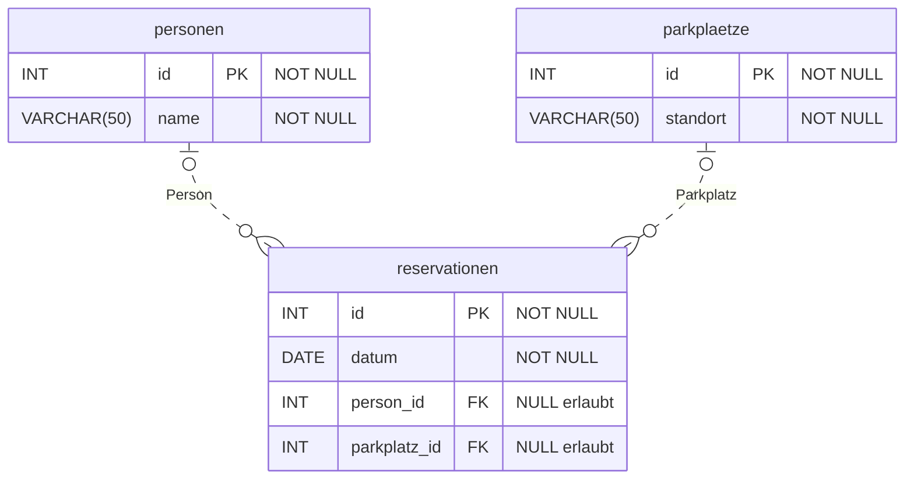

# Parkplatz-Reservation

Eine Reservation hält fest, an welchem Datum eine Person einen Parkplatz beansprucht. Im Beispiel kann eine Reservation schon erfasst werden, bevor ihr ein Parkplatz zugeteilt ist. Das Modell zeigt, welche Zuordnungen MySQL zulässt und wie InnoDB bestehende Verweise schützt.

[Zur Session](../README.md) und [vollständiges MySQL-Skript](Session%2003%20Parkplatz-Reservation.sql)

## Übersicht


## Physisches Datenmodell



**MySQL 8.4:** Schema `parkplatz_reservation`, Zeichensatz `utf8mb4`, für alle Tabellen die Speicher-Engine `InnoDB`. Die IDs werden im Skript von Hand vergeben.

### personen

| Spalte | Datentyp | Regel | Bedeutung |
|---|---|---|---|
| `id` | `INT` | PK, NOT NULL | Eindeutige Personennummer |
| `name` | `VARCHAR(50)` | NOT NULL | Name der Person |

### parkplaetze

| Spalte | Datentyp | Regel | Bedeutung |
|---|---|---|---|
| `id` | `INT` | PK, NOT NULL | Eindeutige Parkplatznummer |
| `standort` | `VARCHAR(50)` | NOT NULL | Standort des Parkplatzes |

### reservationen

| Spalte | Datentyp | Regel | Bedeutung |
|---|---|---|---|
| `id` | `INT` | PK, NOT NULL | Eindeutige Reservationsnummer |
| `datum` | `DATE` | NOT NULL | Reservationstag |
| `person_id` | `INT` | FK auf `personen.id`, NULL erlaubt | Zugeordnete Person |
| `parkplatz_id` | `INT` | FK auf `parkplaetze.id`, NULL erlaubt | Zugeordneter Parkplatz |

## Beziehungen und Schlüssel

- Eine Person kann **null bis viele** Reservationen haben. Eine Reservation verweist auf **null oder eine** Person.
- Ein Parkplatz kann **null bis viele** Reservationen haben. Eine Reservation verweist auf **null oder einen** Parkplatz.
- **Primärschlüssel:** `PRIMARY KEY` erzwingt Eindeutigkeit und schliesst `NULL` aus.
- **Fremdschlüssel:** Eine eingetragene ID muss als Primärschlüssel in der jeweiligen Elterntabelle existieren. Wenn die Fremdschlüsselspalte `NULL` erlaubt, darf die Zuordnung fehlen.
- **Referentielle Integrität:** Es gibt keine eingetragenen Verweise auf Personen oder Parkplätze, die nicht existieren. Ohne abweichende Regel weist InnoDB das Löschen oder Umnummerieren eines noch referenzierten Eintrags zurück.

Das Beispiel verhindert keine Doppelreservationen für denselben Parkplatz am selben Datum. Wenn nur eine Reservation pro zugeteiltem Parkplatz und Tag zulässig sein soll, braucht es zusätzlich `UNIQUE (parkplatz_id, datum)`. Wenn eine Person zwingend angegeben werden muss, braucht `person_id` zusätzlich `NOT NULL`.

## Schritt für Schritt

Öffnen Sie das SQL-Skript in MySQL Workbench. Führen Sie die Anweisungen einzeln aus: Setzen Sie den Cursor in die gewünschte Anweisung und drücken Sie unter Windows `Ctrl+Enter` oder wählen Sie im Menü **Query** den Eintrag **Execute Current Statement**. Bei einer absichtlichen Ablehnung lesen Sie die Meldung und gehen dann zur nächsten Anweisung.

**Achtung:** Die erste Anweisung löscht ein vorhandenes Schema namens `parkplatz_reservation` samt Inhalt. Verwenden Sie das Skript nur auf einer lokalen Übungsinstanz, auf der dieses Schema entbehrlich ist.

### 0. Schema

```sql
DROP DATABASE IF EXISTS parkplatz_reservation;
CREATE DATABASE parkplatz_reservation CHARACTER SET utf8mb4;
USE parkplatz_reservation;
```

**Erwartet:** Das Schema ist leer und aktiv.

### 1. Personen und Parkplätze

```sql
CREATE TABLE personen (
    id   INT PRIMARY KEY,
    name VARCHAR(50) NOT NULL
) ENGINE = InnoDB;

CREATE TABLE parkplaetze (
    id       INT PRIMARY KEY,
    standort VARCHAR(50) NOT NULL
) ENGINE = InnoDB;

INSERT INTO personen (id, name) VALUES (1, 'Maier'), (2, 'Huber');
INSERT INTO parkplaetze (id, standort) VALUES (1, 'Ibis 1'), (2, 'Strasse 1');

SELECT * FROM personen;
SELECT * FROM parkplaetze;
```

**Erwartet:** Beide Tabellen enthalten je zwei Zeilen.

| `personen.id` | `name` |
|---|---|
| 1 | Maier |
| 2 | Huber |

| `parkplaetze.id` | `standort` |
|---|---|
| 1 | Ibis 1 |
| 2 | Strasse 1 |

### 2. Primärschlüssel

```sql
INSERT INTO personen (id, name) VALUES (1, 'Muster');
INSERT INTO personen (id, name) VALUES (NULL, 'Muster');
```

**Erwartet:** Beide Anweisungen werden zurückgewiesen. Die ID 1 ist bereits vergeben; eine Person ohne ID ist nicht zulässig.

### 3. Reservationen

```sql
CREATE TABLE reservationen (
    id           INT PRIMARY KEY,
    datum        DATE NOT NULL,
    person_id    INT NULL,
    parkplatz_id INT NULL,
    CONSTRAINT fk_reservation_person    FOREIGN KEY (person_id)    REFERENCES personen (id),
    CONSTRAINT fk_reservation_parkplatz FOREIGN KEY (parkplatz_id) REFERENCES parkplaetze (id)
) ENGINE = InnoDB;

INSERT INTO reservationen (id, datum, person_id, parkplatz_id)
VALUES (1, '2026-11-28', 1, 1),
       (2, '2026-11-28', 2, 2);

SELECT r.id, r.datum, p.name, pp.standort
FROM reservationen r
JOIN personen p     ON p.id  = r.person_id
JOIN parkplaetze pp ON pp.id = r.parkplatz_id;
```

**Erwartet:** Beide Reservationen werden gespeichert. Der JOIN zeigt Namen und Standorte statt Fremdschlüssel-IDs.

| `id` | `datum` | `name` | `standort` |
|---|---|---|---|
| 1 | 2026-11-28 | Maier | Ibis 1 |
| 2 | 2026-11-28 | Huber | Strasse 1 |

### 4. Fehlender Parkplatz

```sql
INSERT INTO reservationen (id, datum, person_id, parkplatz_id)
VALUES (3, '2026-11-29', 1, 3);
```

**Erwartet:** MySQL weist die Reservation zurück, weil Parkplatz 3 nicht existiert. Die Reservationsnummer 3 bleibt frei.

### 5. Offene Zuordnung

```sql
INSERT INTO reservationen (id, datum, person_id, parkplatz_id)
VALUES (3, '2026-11-29', 1, NULL);
SELECT * FROM reservationen;
```

**Erwartet:** MySQL speichert Reservation 3. `NULL` verweist auf keinen Parkplatz und ist in der Spalte erlaubt.

| `id` | `datum` | `person_id` | `parkplatz_id` |
|---|---|---|---|
| 1 | 2026-11-28 | 1 | 1 |
| 2 | 2026-11-28 | 2 | 2 |
| 3 | 2026-11-29 | 1 | NULL |

### 6. Geschützte Einträge

```sql
DELETE FROM personen WHERE id = 2;
UPDATE parkplaetze SET id = 20 WHERE id = 2;
```

**Erwartet:** Beide Anweisungen werden zurückgewiesen. Reservation 2 verweist noch auf Huber und auf Parkplatz 2.

### 7. Löschreihenfolge

```sql
DELETE FROM reservationen WHERE person_id = 2;
DELETE FROM personen WHERE id = 2;
SELECT * FROM personen;
```

**Erwartet:** Beide Löschungen gelingen. Nach dem Löschen von Reservation 2 gibt es keinen Verweis mehr auf Huber. In `personen` bleibt nur Maier; Parkplatz 2 bleibt bestehen.

### 8. Fremdschlüssel anzeigen

```sql
SHOW CREATE TABLE reservationen;
SELECT constraint_name, table_name, column_name,
       referenced_table_name, referenced_column_name
FROM information_schema.key_column_usage
WHERE table_schema = 'parkplatz_reservation'
  AND referenced_table_name IS NOT NULL;
```

**Erwartet:** Die Tabellendefinition und die Metadaten zeigen beide Fremdschlüssel mit ihren Zieltabellen.

### 9. ON DELETE SET NULL

```sql
ALTER TABLE reservationen DROP FOREIGN KEY fk_reservation_parkplatz;
ALTER TABLE reservationen
    ADD CONSTRAINT fk_reservation_parkplatz
    FOREIGN KEY (parkplatz_id) REFERENCES parkplaetze (id)
    ON DELETE SET NULL;
DELETE FROM parkplaetze WHERE id = 1;
SELECT * FROM reservationen;   -- Reservation 1 hat jetzt parkplatz_id NULL
```

**Erwartet:** Parkplatz 1 wird gelöscht, Reservation 1 bleibt bestehen. InnoDB setzt deren `parkplatz_id` auf `NULL`. Die Zuordnung zu Maier bleibt erhalten.

| `id` | `datum` | `person_id` | `parkplatz_id` |
|---|---|---|---|
| 1 | 2026-11-28 | 1 | NULL |
| 3 | 2026-11-29 | 1 | NULL |

## Vollständiges SQL-Skript

[SQL-Datei für MySQL Workbench](Session%2003%20Parkplatz-Reservation.sql). Die Kommentare markieren die Anweisungen, die absichtlich scheitern.

```sql
-- Parkplatz-Reservationssystem: Referentielle Integrität (MySQL 8.4)
-- Schritt für Schritt ausführen (Ctrl+Enter auf der jeweiligen Anweisung).
-- Anweisungen mit «Erwartet: Fehler» scheitern absichtlich.

DROP DATABASE IF EXISTS parkplatz_reservation;
CREATE DATABASE parkplatz_reservation CHARACTER SET utf8mb4;
USE parkplatz_reservation;

-- 1. Elterntabellen: Personen und Parkplätze
-- PK = UNIQUE + NOT NULL
CREATE TABLE personen (
    id   INT PRIMARY KEY,
    name VARCHAR(50) NOT NULL
) ENGINE = InnoDB;

CREATE TABLE parkplaetze (
    id       INT PRIMARY KEY,
    standort VARCHAR(50) NOT NULL
) ENGINE = InnoDB;

INSERT INTO personen (id, name) VALUES (1, 'Maier'), (2, 'Huber');
INSERT INTO parkplaetze (id, standort) VALUES (1, 'Ibis 1'), (2, 'Strasse 1');

SELECT * FROM personen;
SELECT * FROM parkplaetze;

-- 2. Primärschlüssel testen
-- Erwartet: Fehler, Person 1 gibt es schon
INSERT INTO personen (id, name) VALUES (1, 'Muster');
-- Erwartet: Fehler, ID darf nicht NULL sein
INSERT INTO personen (id, name) VALUES (NULL, 'Muster');

-- 3. Reservationen: Kindtabelle mit zwei Fremdschlüsseln
-- FK: Wert muss als PK in der Elterntabelle existieren oder NULL sein
CREATE TABLE reservationen (
    id           INT PRIMARY KEY,
    datum        DATE NOT NULL,
    person_id    INT NULL,
    parkplatz_id INT NULL,
    CONSTRAINT fk_reservation_person    FOREIGN KEY (person_id)    REFERENCES personen (id),
    CONSTRAINT fk_reservation_parkplatz FOREIGN KEY (parkplatz_id) REFERENCES parkplaetze (id)
) ENGINE = InnoDB;

INSERT INTO reservationen (id, datum, person_id, parkplatz_id)
VALUES (1, '2026-11-28', 1, 1),
       (2, '2026-11-28', 2, 2);

-- Wer hat welchen Parkplatz?
SELECT r.id, r.datum, p.name, pp.standort
FROM reservationen r
JOIN personen p     ON p.id  = r.person_id
JOIN parkplaetze pp ON pp.id = r.parkplatz_id;

-- 4. Reservation auf einen Parkplatz, den es nicht gibt
-- Erwartet: Fehler, Parkplatz 3 existiert nicht
INSERT INTO reservationen (id, datum, person_id, parkplatz_id)
VALUES (3, '2026-11-29', 1, 3);

-- 5. FK darf NULL sein
-- Funktioniert: Reservation ist erfasst, Parkplatz wird später zugeteilt
INSERT INTO reservationen (id, datum, person_id, parkplatz_id)
VALUES (3, '2026-11-29', 1, NULL);
SELECT * FROM reservationen;

-- 6. Person oder Parkplatz entfernen, der noch reserviert ist
-- Erwartet: Fehler, Huber hat noch Reservation 2
DELETE FROM personen WHERE id = 2;
-- Erwartet: Fehler, Parkplatz 2 ist noch reserviert und kann nicht umnummeriert werden
UPDATE parkplaetze SET id = 20 WHERE id = 2;

-- 7. Richtige Reihenfolge: zuerst Reservation, dann Person
DELETE FROM reservationen WHERE person_id = 2;
DELETE FROM personen WHERE id = 2;
SELECT * FROM personen;

-- 8. Regeln anzeigen
SHOW CREATE TABLE reservationen;
SELECT constraint_name, table_name, column_name,
       referenced_table_name, referenced_column_name
FROM information_schema.key_column_usage
WHERE table_schema = 'parkplatz_reservation'
  AND referenced_table_name IS NOT NULL;

-- Bonus: Parkplatz aufheben, Reservationen bleiben ohne Parkplatz bestehen
ALTER TABLE reservationen DROP FOREIGN KEY fk_reservation_parkplatz;
ALTER TABLE reservationen
    ADD CONSTRAINT fk_reservation_parkplatz
    FOREIGN KEY (parkplatz_id) REFERENCES parkplaetze (id)
    ON DELETE SET NULL;
DELETE FROM parkplaetze WHERE id = 1;
SELECT * FROM reservationen;   -- Reservation 1 hat jetzt parkplatz_id NULL
```
