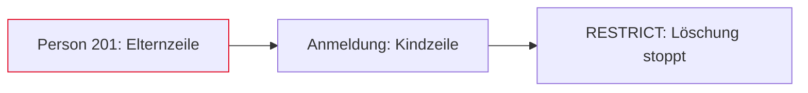
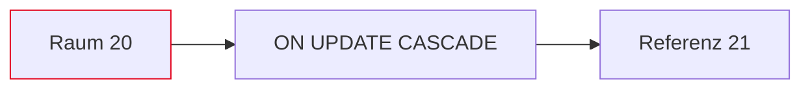
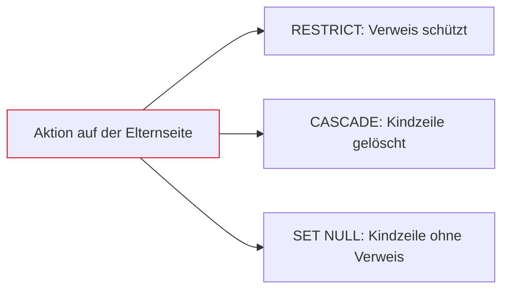
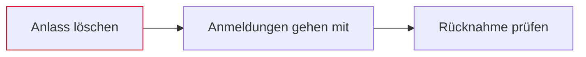

# Datenänderung und Integrität

**Session 04.** EventStar erprobt Änderungen an einem provisorischen Teameintrag. Andere Änderungen betreffen bestehende Verweise und müssen vorher geprüft werden.

**Start.** Laden Sie [Session 04 Start.sql](Session%2004%20Start.sql). Führen Sie jeden Transaktionsblock vollständig und die absichtlich fehlerhafte Anweisung einzeln aus.

### Lernziele

Sie können:

- **Verstehen:** Tabellenstruktur und Datenänderungen unterscheiden.
- **Anwenden:** Eine Zeile per SQL einfügen, ändern und löschen.
- **Anwenden:** Eine Korrektur im selben Tab prüfen und zurücknehmen.
- **Analysieren:** Die Folgen einer Schlüsseländerung oder Löschung ableiten.

## SQL-Grundlagen

### App und Datenbank

Die Benutzerin arbeitet in der App, etwa mit einem Formular. Die App sendet SQL-Anweisungen an MySQL. Der Server liefert Daten, eine Bestätigung oder eine Fehlermeldung zurück. In Workbench übernehmen Sie selbst den Schritt, den sonst die App ausführt.


### SQL-Befehlsgruppen


SQL steht für **Structured Query Language**. Die Gruppen zeigen, wofür ein Befehl eingesetzt wird. Hier steht DQL separat für das Abfragen; manche Darstellungen zählen auch `SELECT` zu DML.

### MySQL-Kurzreferenz

Die Beispiele verwenden ein separates Übungsschema ohne Kursdaten. Führen Sie die Beispiele für Struktur und Zeilen bei Bedarf von oben nach unten aus. Die DCL-Beispiele setzen eine bestehende Rolle `es_leser` und entsprechende Verwaltungsrechte voraus. Eine Transaktion endet entweder mit `COMMIT` oder mit `ROLLBACK`.

| Struktur (DDL und Schemawahl) | Beispiel |
|---|---|
| Datenbank anlegen | `CREATE DATABASE es_sql_labor;` |
| Datenbank auswählen | `USE es_sql_labor;` |
| Tabelle anlegen | `CREATE TABLE servicetermine (nr INT PRIMARY KEY);` |
| Spalte ergänzen | `ALTER TABLE servicetermine ADD COLUMN status VARCHAR(20);` |
| Tabelle umbenennen | `RENAME TABLE servicearchiv TO alte_termine;` |
| Tabelle leeren | `TRUNCATE TABLE alte_termine;` |
| Tabelle entfernen | `DROP TABLE alte_termine;` |

Legen Sie für die drei Archivbefehle zuerst eine leere Tabelle an: `CREATE TABLE servicearchiv (nr INT PRIMARY KEY);`. `TRUNCATE TABLE` leert die ganze Tabelle, `DROP TABLE` entfernt auch ihre Struktur. Mehr zu Typen, Schlüsseln und Regeln: [Aufbau von CREATE TABLE in Session 02](../Session%2002/Session%2002%20Theorie.md#aufbau-von-create-table).

| Zeilen und Rechte | Beispiel |
|---|---|
| Einfügen (DML) | `INSERT INTO servicetermine (nr, status) VALUES (7, 'offen');` |
| Lesen (DQL) | `SELECT nr, status FROM servicetermine WHERE nr = 7;` |
| Ändern (DML) | `UPDATE servicetermine SET status = 'erledigt' WHERE nr = 7;` |
| Löschen (DML) | `DELETE FROM servicetermine WHERE nr = 7;` |
| Leserecht gewähren (DCL) | `GRANT SELECT ON es_sql_labor.servicetermine TO 'es_leser';` |
| Leserecht entziehen (DCL) | `REVOKE SELECT ON es_sql_labor.servicetermine FROM 'es_leser';` |

| Transaktionen (TCL) | Beispiel |
|---|---|
| Beginnen | `START TRANSACTION;` |
| Änderungen bestätigen | `COMMIT;` |
| Änderungen zurücknehmen | `ROLLBACK;` |

### CRUD

CRUD beschreibt vier Aktionen auf **Datenzeilen**: Create legt eine Zeile an, Read liest sie, Update ändert sie und Delete entfernt sie. In der Grafik liest die App Reservation 101 und ändert nur den Parkplatz von 102. **CRUD Create bedeutet `INSERT`, nicht `CREATE TABLE`.** Letzteres legt die Struktur an und gehört zur DDL.


### Geschichte


1970 beschrieb Edgar F. Codd das relationale Modell. Im IBM-Forschungsprojekt System R entwickelten Donald D. Chamberlin und Raymond F. Boyce die Abfragesprache SEQUEL (1974); daraus wurde SQL. Oracle brachte 1979 das erste kommerziell verfügbare SQL-basierte relationale Datenbanksystem auf den Markt. ANSI standardisierte SQL 1986, ISO folgte 1987. Auf SQL-92 folgten unter anderem SQL:1999, SQL:2003 und SQL:2023.

Der Standard ist die gemeinsame Basis. MySQL und PostgreSQL unterstützen jedoch nicht alle Details gleich. SQL Server verwendet Transact-SQL (T-SQL); Oracle Database bietet mit PL/SQL eine prozedurale Erweiterung zu SQL. Deshalb sind die Beispiele hier für MySQL geschrieben.

[IBM: Relational Database](https://www.ibm.com/history/relational-database) / [SEQUEL, Originalpublikation](https://doi.org/10.1145/800296.811515) / [PostgreSQL: SQL-Standards](https://www.postgresql.org/docs/current/features.html)

### Aufbau eines SQL-Statements

Ein Statement ist eine Anweisung. **Schlüsselwörter** wie `SELECT` und `WHERE` bilden die **Klauseln**. **Bezeichner** benennen Tabellen und Spalten, **Literale** sind feste Werte wie `7` und `'erledigt'`. In Workbench grenzt das Semikolon Anweisungen voneinander ab. SQL-Schlüsselwörter sind unabhängig von Gross- und Kleinschreibung; schreiben Sie Bezeichner so, wie sie angelegt wurden.


Einfache Anführungszeichen stehen für Textwerte (`'erledigt'`), Backticks in MySQL für Bezeichner (`` `status` ``). `-- ` leitet bis zum Zeilenende einen Kommentar ein (in MySQL mit Leerzeichen nach den Strichen); `/* ... */` umschliesst einen Blockkommentar.

**Schreibreihenfolge bei SELECT:** `SELECT` – `FROM` – `WHERE` – `GROUP BY` – `HAVING` – `ORDER BY` – `LIMIT`. Nicht jede Abfrage braucht alle Klauseln. `WHERE` filtert Zeilen, `HAVING` filtert Gruppen. [Session 06](../Session%2006/Session%2006%20Theorie.md) vertieft Filter und Gruppierung.

## Gezielte Datenänderungen

### Zielzeilen

Lesen Sie die Zielzeile und ihren Schlüssel, bevor Sie im Raster oder per SQL arbeiten.


```sql
SELECT mitarbeitenden_id, name FROM mitarbeitende
WHERE mitarbeitenden_id = 3;
```

| Person | Name |
| --- | --- |
| 3 | Noa Licht |

**Was prüfe ich?** DESCRIBE zeigt Struktur und Regeln. SELECT zeigt die gespeicherte Zielzeile.

### Änderungsbefehle und Sicherheit

INSERT nennt am besten die Zielspalten ausdrücklich. Eine Werteliste fügt eine Zeile ein, mehrere durch Komma getrennte Wertelisten mehrere Zeilen. UPDATE setzt die angegebenen Spalten für alle Treffer. DELETE entfernt ganze Zeilen. Die Beispieltabelle `etikett` zeigt hier das allgemeine Muster; die geführten Versuche verwenden die vorbereiteten EventStar-Tabellen.

| Befehl | Syntaxmuster |
|---|---|
| INSERT | `INSERT INTO etikett (id, text) VALUES (51, 'Kabel'), (52, 'Stative');` |
| UPDATE | `UPDATE etikett SET text = 'Mikrofone' WHERE id = 51;` |
| DELETE | `DELETE FROM etikett WHERE id = 52;` |
| TRUNCATE | `TRUNCATE TABLE etikett;` |

Ohne WHERE betrifft UPDATE oder DELETE alle Zeilen. Testen Sie das Prädikat vorher mit SELECT; die Sitzungseinstellung `SQL_SAFE_UPDATES` kann in MySQL UPDATE/DELETE ohne Schlüsselkriterium oder LIMIT abweisen (Fehler 1175), ersetzt die Zielkontrolle aber nicht. TRUNCATE leert die gesamte Tabelle, hat kein WHERE, setzt AUTO_INCREMENT zurück, ist durch Fremdschlüssel eingeschränkt und löst in MySQL einen impliziten Commit aus. Ein InnoDB-DELETE lässt sich dagegen vor dem COMMIT zurücknehmen. Nutzen Sie das Transaktionsmuster aus [Session 01](../Session%2001/Session%2001%20Theorie.md#transaktion).

UPDATE kann mit dem bisherigen Wert rechnen, zum Beispiel `SET menge = menge * 2`. Bei zwei benötigten Werten aus derselben neu eingefügten Zeile lässt sich der automatisch erzeugte Schlüssel mit LAST_INSERT_ID() in derselben Verbindung abfragen. Ermitteln Sie den Schlüssel unmittelbar nach dem einzelnen INSERT und speichern Sie ihn für die Folgeanweisungen; MAX(id) könnte bereits eine Zeile einer anderen Verbindung liefern.

Eine Anonymisierung lässt die Zeile und ihre Referenzen bestehen, ersetzt aber identifizierende Angaben. Ob die Daten danach tatsächlich anonym sind, hängt auch von den übrigen Daten und Verknüpfungen ab. Für eine spätere Wiederherstellung sichern Sie vor dem Löschen die betroffenen Zeilen samt Schlüssel separat; ROLLBACK hilft nur vor der Bestätigung.

Für eine Sammelkorrektur begrenzt WHERE die Zielmenge nach einer Fachregel. Wenn eine Zeile nur ohne abhängige Einträge gelöscht werden darf, prüfen Sie diese Bedingung in der Löschanweisung selbst. `NOT EXISTS (SELECT 1 FROM kind WHERE kind.eltern_id = eltern.id)` ist wahr, wenn keine passende Kindzeile existiert. Prüfen Sie dieselbe Bedingung vorher mit SELECT; ein RESTRICT-Fremdschlüssel bleibt der Schutz gegen eine unbeabsichtigte Löschung. [Session 07](../Session%2007/Session%2007%20Theorie.md#join-arten-und-unterabfragen) erklärt die Unterabfrage.

### INSERT, UPDATE, DELETE

Ein provisorischer Teameintrag wird eingefügt, umbenannt und wieder gelöscht. Führen Sie den Versuch vollständig aus.


```sql
START TRANSACTION;
INSERT INTO mitarbeitende (mitarbeitenden_id, name) VALUES (8, 'Kim Bach');
UPDATE mitarbeitende SET name = 'Kim Berg' WHERE mitarbeitenden_id = 8;
SELECT name FROM mitarbeitende WHERE mitarbeitenden_id = 8;
DELETE FROM mitarbeitende WHERE mitarbeitenden_id = 8;
SELECT COUNT(*) AS verbleibend FROM mitarbeitende WHERE mitarbeitenden_id = 8;
ROLLBACK;
```

| Erste Ausgabe | Zweite Ausgabe |
| --- | --- |
| Kim Berg | 0 |

**Was prüfe ich?** Die erste Ausgabe bestätigt die Änderung, die zweite die Löschung. ROLLBACK beendet den Versuch ohne Übernahme.

## Referenzielle Integrität

### Fehler 1451

Die Buchhaltung möchte Person 201 aus der Teilnehmendenliste entfernen. Eine Anmeldung verweist noch auf diese Person.



```sql
DELETE FROM teilnehmende WHERE teilnehmenden_id = 201;
```

```text
ERROR 1451: Cannot delete or update a parent row: a foreign key constraint fails
```

**Was prüfe ich?** 1451 bedeutet, dass noch eine Kindzeile verweist. Eine Person mit bestehender Anmeldung lässt sich nicht direkt löschen.

### Schlüsseländerung

Der zweite Kursraum wird umnummeriert. Die Veranstaltung behält ihren eigenen Schlüssel; nur ihr Raumverweis wird mitgeführt.



```sql
START TRANSACTION;
UPDATE raeume SET raum_id = 21 WHERE raum_id = 20;
SELECT raum_id FROM veranstaltungen WHERE veranstaltungs_id = 102;
ROLLBACK;
SELECT raum_id FROM veranstaltungen WHERE veranstaltungs_id = 102;
```

| Während des Versuchs | Nach ROLLBACK |
| --- | --- |
| 21 | 20 |

**Was prüfe ich?** Beide Abfragen lesen Veranstaltung 102. Nur der Raumverweis ändert sich und wird beim ROLLBACK wieder zurückgesetzt.

### Löschaktionen

Der Versuch legt eine provisorische Anmeldung fürs Tonstudio an. ON DELETE CASCADE entfernt diese Anmeldung beim Löschen der Veranstaltung. SET NULL würde die Kindzeile behalten und nur den Verweis entfernen.



```sql
START TRANSACTION;
INSERT INTO anmeldungen (veranstaltungs_id, teilnehmenden_id) VALUES (102, 202);
DELETE FROM veranstaltungen WHERE veranstaltungs_id = 102;
SELECT COUNT(*) AS anmeldungen FROM anmeldungen WHERE veranstaltungs_id = 102;
ROLLBACK;
```

| Anmeldungen nach Löschung |
| --- |
| 0 |

**Was prüfe ich?** Es gibt kein eigenes DELETE auf der Anmeldung. Die Löschaktion findet über den Fremdschlüssel statt.



### Browser-Übung

Öffnen Sie [DB Fiddle](https://www.db-fiddle.com/) und wählen Sie eine angebotene MySQL-8-Version. Der Editor ist leer. Kopieren Sie das Startschema in «Schema SQL» und die Abfrage in «Query SQL».

<details>
<summary>Startschema für den Browser</summary>

```sql
CREATE TABLE kategorie (id INT PRIMARY KEY);
CREATE TABLE inventar (id INT PRIMARY KEY, kategorie_id INT,
    FOREIGN KEY (kategorie_id) REFERENCES kategorie(id) ON UPDATE CASCADE);
INSERT INTO kategorie VALUES (4);
INSERT INTO inventar VALUES (71, 4);
```

</details>

```sql
UPDATE kategorie SET id = 9 WHERE id = 4;
SELECT * FROM inventar;
```

### Selbstcheck

<details>
<summary>Welche zwei Bedingungen braucht das Ändern einer einzelnen Anmeldung?</summary>

WHERE muss sowohl den Anlass als auch die teilnehmende Person angeben.

</details>

<details>
<summary>Wann passt SET NULL statt CASCADE?</summary>

Wenn die Kindzeile fachlich bestehen bleiben soll und die Zuordnung optional ist.

</details>

## Änderungsprobe

### Transfer

**Basis:** Sagen Sie im Arbeitsblatt vor der nächsten Aktion voraus, welche Zeile sich ändert. **Vertiefung:** Prüfen und dokumentieren Sie den Unterschied zwischen gesperrter Löschung und Löschweitergabe im selben Schema.

[Arbeitsblatt zum Ausfüllen](Session%2004%20Arbeitsblatt.docx)

### Freiwillige Übungen

[Übungen zu dieser Session](Session%2004%20%C3%9Cbungen.md).
