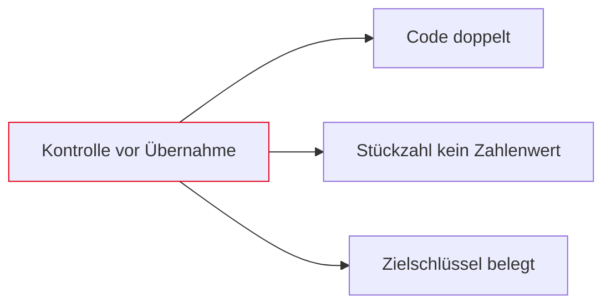
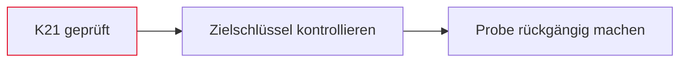

# Datenimport und Datenexport

**Session 05.** EventStar führt Geräte aus zwei Inventarquellen zusammen. Gerätecodes und Stückzahlen kommen als Text an; nicht jede Zeile eignet sich für die Übernahme.

**Start.** Führen Sie [Session 05 EventStar.sql](Session%2005%20EventStar.sql) aus. Die Theorie verwendet danach das separate Schema eventstar_inventar.

### Lernziele

Sie können:

- **Verstehen:** Sicherung und Dateiaustausch am Zweck unterscheiden.
- **Anwenden:** Einen Dump in einem separaten Schema wiederherstellen.
- **Anwenden:** Rohwerte aufbereiten, prüfen und gültige Zeilen übernehmen.
- **Analysieren:** Unterschiede zwischen Eingang, Zielbestand und Export erklären.

## Sicherung

### Dump und Arbeitskopie

Ein Dump kann Daten und Struktur enthalten. Sichern Sie hier bewusst nur die Raumtabelle und spielen Sie sie in ein leeres Schema zurück.


```bash
mysqldump -u root -p --single-transaction --no-tablespaces eventstar_05 raeume > raeume.sql
mysql -u root -p -e "CREATE DATABASE eventstar_inventar CHARACTER SET utf8mb4"
mysql -u root -p eventstar_inventar < raeume.sql
```

Wechseln Sie in Workbench in das Schema `eventstar_inventar`. Führen Sie dort den folgenden SQL-Block aus.

```sql
SELECT COUNT(*) AS raeume_in_kopie FROM raeume;
```

| Räume |
| --- |
| 4 |

**Was prüfe ich?** SHOW TABLES zeigt nach der Wiederherstellung nur die Raumtabelle. Der Dump ist kein vollständiges Backup der Datenbank.

## Rohdatenprüfung

### Importwege

| Methode | Quelle | Aufwand bei grossen Mengen | Fehler und Einsatz |
|---|---|---|---|
| LOAD DATA INFILE | Datei auf dem Server | Gering | CSV schnell laden; Serverpfad und FILE-Recht nötig. |
| LOAD DATA LOCAL INFILE | Datei beim Client | Gering, zusätzlicher Transfer | Für lokale CSV; Warnungen prüfen und Rohdaten per Zwischentabelle kontrollieren. |
| INSERT mit VALUES | Werte in SQL | Sinnvoll für kleine Mengen | Gut für Testdaten; Regeln greifen direkt beim Einfügen. |
| INSERT … SELECT | Abfrage oder Zwischentabelle | Gering im selben Server | Übernimmt geprüfte Zeilen; Verweise und Dubletten vorab prüfen. |
| JSON_TABLE | JSON-Array | Mengenorientiert | Wandelt Objekte in Zeilen; Feldfehler bewusst behandeln. |
| Dump wiederherstellen | SQL-Datei | Umfang abhängig | Führt die SQL-Anweisungen des Dumps aus; Struktur und Daten wiederherstellen. |
| Workbench-Assistent | Lokale CSV oder JSON | Interaktiv | Praktisch für kleine Dateien; Vorschau und Typzuordnung prüfen. |

### CSV mit LOAD DATA

Diese CSV listet erwartete Gerätepakete. Speichern Sie sie als UTF-8 mit LF-Zeilenenden unter `geraetepakete.csv`. Führen Sie die Beispiele im selben SQL-Tab aus, da die Probentabellen temporär sind.

```text
code;lieferdatum;stueck
K13;03.03.2027;12
K24;04.03.2027;
```

```sql
CREATE TEMPORARY TABLE lieferprobe (
    code CHAR(3) PRIMARY KEY, lieferdatum DATE NOT NULL, stueck INT DEFAULT NULL
);
CREATE TEMPORARY TABLE lieferziel LIKE lieferprobe;
```

`LOCAL` liest die Datei relativ zum Arbeitsverzeichnis des Clients. Lokaler Client und Server müssen den Modus erlauben (`mysql --local-infile=1` und Servervariable `local_infile`). Ein deaktivierter Modus kann Fehler 3948 liefern. Aktivieren Sie ihn nur für das lokale Übungssystem. Bei LOCAL können unter anderem Konvertierungsfehler zu Warnungen werden: Prüfen Sie unmittelbar danach `SHOW WARNINGS`. Prüfen Sie Trennzeichen, Kopfzeile, Anführungszeichen und Zeilenenden; bei CRLF verwenden Sie `LINES TERMINATED BY '\r\n'`. Verwenden Sie für unbereinigte Quellen zuerst Textspalten in der Rohtabelle.

```sql
LOAD DATA LOCAL INFILE 'geraetepakete.csv'
INTO TABLE lieferprobe CHARACTER SET utf8mb4
FIELDS TERMINATED BY ';' OPTIONALLY ENCLOSED BY '"'
LINES TERMINATED BY '\n'
IGNORE 1 LINES
(code, @lieferdatum, @stueck)
SET lieferdatum = STR_TO_DATE(@lieferdatum, '%d.%m.%Y'),
    stueck = NULLIF(@stueck, '');
SELECT * FROM lieferprobe ORDER BY code;
```

Ohne LOCAL liest der Server. Prüfen Sie zuerst `SHOW VARIABLES LIKE 'secure_file_priv'`: Ein Verzeichnis beschränkt erlaubte Pfade, NULL deaktiviert den Dateiimport für den Server, eine leere Einstellung setzt keine solche Verzeichnisbeschränkung. Der Serverprozess muss die Datei lesen können, und der SQL-Benutzer braucht das FILE-Recht. Ein nicht erlaubter Pfad löst bei eingeschränktem `secure_file_priv` Fehler 1290 aus. Hier liegt die separate Beispieldatei im erlaubten Verzeichnis einer isolierten Kursinstanz:

Verwenden Sie beim Wechsel vom LOCAL-Beispiel eine neue Datenbankverbindung und führen Sie dort zuerst den Aufbau der Probentabellen erneut aus. Andernfalls wären beide Paketcodes bereits vorhanden.

```sql
LOAD DATA INFILE '/var/lib/mysql-files/geraetepakete.csv'
INTO TABLE lieferprobe CHARACTER SET utf8mb4
FIELDS TERMINATED BY ';' OPTIONALLY ENCLOSED BY '"'
LINES TERMINATED BY '\n'
IGNORE 1 LINES
(code, @lieferdatum, @stueck)
SET lieferdatum = STR_TO_DATE(@lieferdatum, '%d.%m.%Y'),
    stueck = NULLIF(@stueck, '');
SELECT * FROM lieferprobe ORDER BY code;
```

| Code | Lieferdatum | Stück |
|---|---|---|
| K13 | 2027-03-03 | 12 |
| K24 | 2027-03-04 | NULL |

**Was prüfe ich?** `IGNORE 1 LINES` überspringt nur die Kopfzeile. `NULLIF` macht aus einer leeren Stückzahl NULL. `STR_TO_DATE` liest die angegebene Datumsstruktur. `CHARACTER SET utf8mb4` beschreibt die Kodierung der Datei; die Kollation der Zielspalte bestimmt erst den Zeichenvergleich.

### Zeilen und Schlüsselkonflikte

Ein leeres CSV-Feld in einer vorhandenen Spalte ist nicht dasselbe wie eine im Zielbefehl ausgelassene Spalte. Für ein optionales Feld macht `NULLIF(TRIM(@wert), '')` den leeren Text zu SQL-NULL. Soll stattdessen ein Vorgabewert gelten, verwenden Sie nach der Kontrolle `COALESCE(NULLIF(TRIM(@wert), ''), DEFAULT(stueck))` für eine Zielspalte mit passendem Standardwert, oder lassen Sie die Zielspalte bei INSERT ganz aus. Steht in einer Zeile ein Feld weniger als in der Kopfzeile, prüfen Sie zuerst Dateistruktur und Warnungen; ersetzen Sie fehlende Werte nicht unbemerkt.

Die Zielkopie startet leer. Führen Sie den folgenden Block nach einem erfolgreichen CSV-Import aus.

```sql
INSERT INTO lieferziel (code, lieferdatum, stueck)
SELECT code, lieferdatum, stueck FROM lieferprobe;
INSERT INTO lieferziel VALUES ('K31', '2027-03-05', 7), ('K42', '2027-03-06', 6);
INSERT IGNORE INTO lieferziel VALUES ('K31', '2027-03-05', 99);
SHOW WARNINGS;
INSERT INTO lieferziel VALUES ('K31', '2027-03-05', 8)
    ON DUPLICATE KEY UPDATE stueck = 8;
REPLACE INTO lieferziel (code, lieferdatum) VALUES ('K42', '2027-03-06');
SELECT * FROM lieferziel ORDER BY code;
```

| Code | Lieferdatum | Stück |
|---|---|---|
| K13 | 2027-03-03 | 12 |
| K24 | 2027-03-04 | NULL |
| K31 | 2027-03-05 | 8 |
| K42 | 2027-03-06 | NULL |

`INSERT IGNORE` überspringt den doppelten Schlüssel und kann auch andere Fehler in Warnungen umwandeln. `ON DUPLICATE KEY UPDATE` ändert die vorhandene Zeile gezielt. `REPLACE` kann dagegen erst löschen und dann neu einfügen: Nicht angegebene Spalten erhalten ihre Standardwerte; Löschaktionen und Trigger können wirken. Wählen Sie REPLACE nicht als neutralen Ersatz für UPDATE.

### JSON mit JSON_TABLE

JSON_TABLE liest aus jedem Objekt des Arrays eine Zeile. `ERROR ON EMPTY` verlangt das Feld für den Paketcode; `NULL ON EMPTY` lässt eine fehlende Stückzahl zu.

```sql
SELECT j.code, j.stueck
FROM JSON_TABLE('[{"code":"K53","stueck":3},{"code":"K64"}]', '$[*]'
    COLUMNS (code CHAR(3) PATH '$.code' ERROR ON EMPTY,
             stueck INT PATH '$.stueck' NULL ON EMPTY)
) AS j ORDER BY j.code;
```

| Code | Stück |
|---|---|
| K53 | 3 |
| K64 | NULL |

### Dump und Workbench-Assistent

Der Terminalblock am Anfang zeigt die Wiederherstellung von `raeume.sql`. Alternativ im gestarteten MySQL-Client: `USE eventstar_inventar;` und dann `SOURCE /pfad/raeume.sql`. SOURCE ist ein Clientbefehl, kein SQL-Befehl für den Server. Prüfen Sie, ob der Dump selbst USE oder CREATE DATABASE enthält.

Für CSV oder JSON in Workbench: Im Schema-Baum Rechtsklick auf «Tables», «Table Data Import Wizard» wählen, Datei auswählen, Zieltabelle festlegen, Feldzuordnung und Typen in der Vorschau kontrollieren, Import starten und Ergebnisprotokoll sowie Anzahl per SELECT prüfen. Für die Semikolondatei oben den Feldtrenner entsprechend einstellen.


**Export:** `mysqldump` erzeugt einen SQL-Dump; der «Table Data Export Wizard» erzeugt CSV oder JSON. `SELECT … INTO OUTFILE` schreibt auf dem Server mit FILE-Recht und unter `secure_file_priv`; die Datei darf noch nicht existieren. Eine JSON-Abfrage kann mit JSON_OBJECT und JSON_ARRAYAGG eine strukturierte Ausgabe bilden.

### Rohtabelle und Zielbestand

Die Rohtabelle hält Eingabewerte als Text fest. Damit können Sie auch ungültige Zeilen untersuchen, ohne sie bereits in den Zielbestand zu übernehmen. Erst nach Format- und Dublettenprüfung wird geschrieben.

| Eingabe | Rohtabelle | Zieltabelle |
| --- | --- | --- |
|  03  | Text unverändert | 3 nach Kontrolle |
| vier | Text unverändert | Keine Übernahme |

**Was prüfe ich?** Vergleichen Sie den Rohwert mit dem Zielwert. Eine abgelehnte Zeile bleibt in der Rohtabelle nachvollziehbar.

### CSV und JSON

Der Bestand der Geräte verwendet eigene Testdaten. Legen Sie die beiden Tabellen an und zählen Sie die Rohzeilen nach Quelle.


```sql
DROP TABLE IF EXISTS theorie_geraete, theorie_inventar_roh;
CREATE TABLE theorie_inventar_roh (
    nr INT PRIMARY KEY, quelle VARCHAR(8), code VARCHAR(12), stueck VARCHAR(12)
);
CREATE TABLE theorie_geraete (code VARCHAR(12) PRIMARY KEY, stueck INT NOT NULL);
INSERT INTO theorie_inventar_roh VALUES
    (1, 'Lager', ' P07 ', ' 03 '), (2, 'Lager', 'S12', 'vier'),
    (3, 'Inventur', 'P07', '3'), (4, 'Inventur', 'K21', '2');
SELECT quelle, COUNT(*) AS anzahl
FROM theorie_inventar_roh GROUP BY quelle ORDER BY quelle;
```

| Quelle | Zeilen |
| --- | --- |
| Inventur | 2 |
| Lager | 2 |

**Was prüfe ich?** Die Summe ist vier. Die Zählung beurteilt weder den Inhalt noch doppelte Codes.

### Textaufbereitung

Entfernen Sie Leerzeichen. Wandeln Sie nur numerischen Text in eine Zahl um; der ungeprüfte Text bleibt in der Rohtabelle.


```sql
SELECT nr, TRIM(code) AS code, CASE
    WHEN TRIM(stueck) REGEXP '^[0-9]{1,4}$' THEN CAST(TRIM(stueck) AS UNSIGNED)
END AS menge
FROM theorie_inventar_roh WHERE nr <= 2 ORDER BY nr;
```

| Nummer | Code | Menge |
| --- | --- | --- |
| 1 | P07 | 3 |
| 2 | S12 | NULL |

**Was prüfe ich?** NULL bedeutet hier, dass die Umwandlung nicht vorgenommen wurde. Ein gültiges Format ersetzt keine Kontrolle des erlaubten Wertebereichs.

### Dubletten und Verweise

Doppelte Codes fallen erst nach dem Bereinigen der Leerzeichen sicher auf. Die Abfrage listet nur verdächtige Gruppen.



```sql
SELECT TRIM(code) AS code, COUNT(*) AS vorkommen
FROM theorie_inventar_roh GROUP BY TRIM(code)
HAVING COUNT(*) > 1;
```

| Code | Vorkommen |
| --- | --- |
| P07 | 2 |

**Was prüfe ich?** Die Abfrage entscheidet nicht, welche Quelle korrekt ist. Prüfen Sie die Duplikate vor der Übernahme.

## Übernahme und Export

### Übernahme und Kontrolle

Code K21 ist eindeutig und hat eine gültige Stückzahl. Übernehmen Sie nur diese kontrollierte Zeile und machen Sie den Versuch rückgängig.



```sql
START TRANSACTION;
INSERT INTO theorie_geraete (code, stueck)
SELECT TRIM(r.code), CAST(TRIM(r.stueck) AS UNSIGNED)
FROM theorie_inventar_roh AS r
WHERE r.nr = 4 AND NOT EXISTS (
    SELECT 1 FROM theorie_geraete AS g WHERE g.code = TRIM(r.code)
);
SELECT ROW_COUNT() AS eingefuegt;
ROLLBACK;
```

| Eingefügt |
| --- |
| 1 |

**Was prüfe ich?** ROW_COUNT zeigt die Zahl der eingefügten Zeilen. ROLLBACK lässt die Zielprobe leer.


### Browser-Übung

Öffnen Sie [DB Fiddle](https://www.db-fiddle.com/) und wählen Sie eine angebotene MySQL-8-Version. Der Editor ist leer. Kopieren Sie das Startschema in «Schema SQL» und die Abfrage in «Query SQL».

<details>
<summary>Startschema für den Browser</summary>

```sql
CREATE TABLE inventar_roh (code VARCHAR(12), stueck VARCHAR(12));
INSERT INTO inventar_roh VALUES (' P07 ', ' 03 '), (' S12 ', 'vier');
```

</details>

```sql
SELECT TRIM(code), TRIM(stueck) REGEXP '^[0-9]+$' AS ist_zahl FROM inventar_roh ORDER BY code;
```

### Selbstcheck

<details>
<summary>Warum prüfen Sie Stückzahlen vor CAST?</summary>

Die Rohtabelle kann Wörter wie «vier» enthalten. Nur gültiger Text soll in eine Zahl umgewandelt werden.

</details>

<details>
<summary>Warum prüfen Sie P07 vor der Übernahme?</summary>

Der bereinigte Code kommt in zwei Quellen vor. Die Übernahmeregel muss festlegen, welche Zeile gilt.

</details>

### Transfer

**Basis:** Erklären Sie, welche Kontrollen sich auf andere Rohdaten übertragen lassen. **Vertiefung:** Begründen Sie im Arbeitsblatt Ihre Entscheidungen für alle abgelehnten Zeilen.

[Arbeitsblatt zum Ausfüllen](Session%2005%20Arbeitsblatt.docx)

### Freiwillige Übungen

[Übungen zu dieser Session](Session%2005%20%C3%9Cbungen.md).
