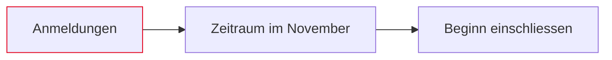
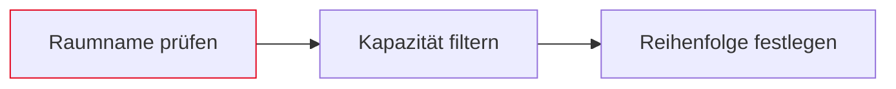
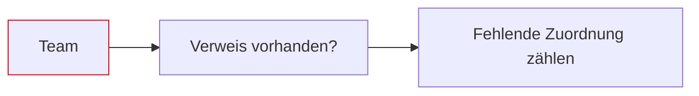
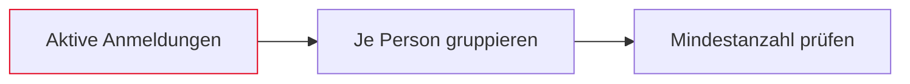
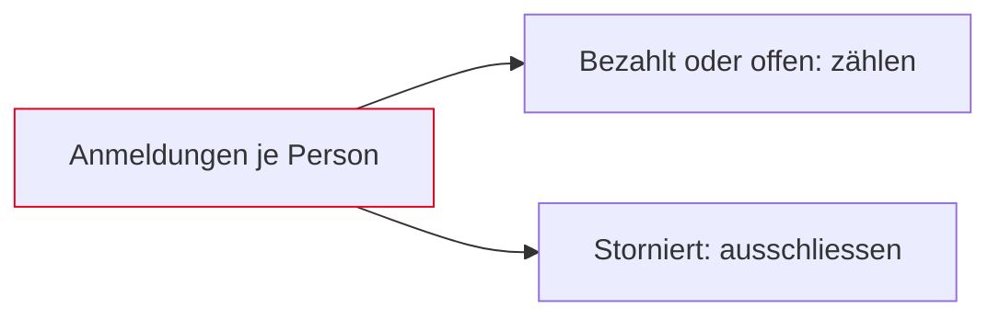
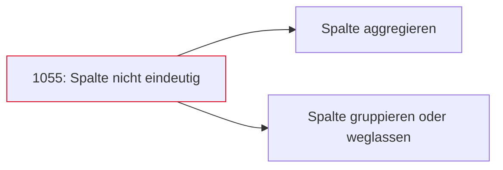

# Filter und Gruppierung

**Session 06.** EventStar möchte die Eingänge einer Novemberwoche prüfen und wissen, welche Räume sich für eine grössere Gruppe eignen.

**Start.** Öffnen Sie die Teams-Besprechung und laden Sie [Session 06 EventStar.sql](Session%2006%20EventStar.sql) lokal in Workbench. Vergleichen Sie ausgewählte Resultate im Teams-Chat.

### Lernziele

Sie können:

- **Anwenden:** Spalten auswählen und Treffer eindeutig sortieren.
- **Anwenden:** Text, Zeitraum und fehlende Werte mit SQL filtern.
- **Analysieren:** Zeilen- und Gruppenfilter einer Abfrage unterscheiden.
- **Beurteilen:** Eine Zählung anhand der fehlenden Werte beurteilen.

## Auswahl und Sortierung

### SELECT-Auswertung

Geschrieben wird `SELECT … FROM … WHERE … GROUP BY … HAVING … ORDER BY … LIMIT …`. Für das Verständnis hilft diese vereinfachte logische Reihenfolge: FROM und JOIN bilden die Eingabe, WHERE filtert Zeilen, GROUP BY bildet Gruppen, HAVING filtert Gruppen, SELECT bestimmt die Ausgabe, ORDER BY sortiert, LIMIT begrenzt. Der Optimierer darf intern einen anderen Weg nehmen, wenn er dasselbe Resultat liefert.

| Werkzeug | EventStar-Beispiel |
|---|---|
| Vergleich und Logik | `preis >= 20 AND preis < 50`; Klammern bei gemischtem AND/OR bewusst setzen. |
| IN und BETWEEN | `status IN ('offen', 'bezahlt')`; BETWEEN schliesst beide Grenzen ein, weshalb für Monatsgrenzen ein halboffenes Intervall besser passt. |
| LIKE | `titel LIKE 'Licht%'`; % steht für beliebig viele Zeichen, _ für genau eines. Gross-/Kleinschreibung hängt von der Kollation ab. |
| NULL | `vorgesetzten_id IS NULL`, nicht `= NULL`. WHERE behält nur TRUE, nicht UNKNOWN. |
| Aggregate | COUNT(*) zählt Zeilen, COUNT(spalte) nur Werte ungleich NULL; SUM und AVG ignorieren NULL. MIN und MAX liefern den kleinsten bzw. grössten vorhandenen Wert. |
| Topliste | `ORDER BY kapazitaet DESC, raum_id LIMIT 3`; der Schlüssel bricht Gleichstände. Für TOP und FETCH siehe den Vergleich in [Session 02](../Session%2002/Session%2002%20Theorie.md#unterschiede-zwischen-datenbanksystemen). |

**Was prüfe ich?** Angenommen, nur zwei Anmeldungen mit Preisangabe stimmen mit dem Filter überein, eine dritte hat NULL: COUNT(*) ergibt 3, COUNT(preis) 2. Die Mindestgrösse einer fertigen Gruppe steht in HAVING, nicht in WHERE.

### Textwerte und Kennzahlen

NULL, leerer Text und ein Text nur aus Leerzeichen sind verschiedene Eingaben. `NULLIF(TRIM(spalte), '') IS NULL` erkennt alle drei in einer Filterbedingung. Damit ist aber kein Format geprüft. COUNT(DISTINCT spalte) zählt verschiedene bekannte Werte. ROUND rundet das Ergebnis, etwa `ROUND(AVG(wert), 2)`; das ist nicht dasselbe wie alle Eingangswerte einzeln zu runden. Für einen relativen Zeitraum liefert `CURRENT_DATE - INTERVAL 14 DAY` in MySQL das Datum vor vierzehn Tagen.

### Zeitraum

Die Eingangsliste enthält Anmeldungen aus mehreren Wochen. Ein halboffenes Intervall umfasst hier den 5. und 6. November vollständig.



```sql
SELECT veranstaltungs_id, teilnehmenden_id, erfasst_am FROM anmeldungen
WHERE erfasst_am >= '2026-11-05' AND erfasst_am < '2026-11-07'
ORDER BY erfasst_am, veranstaltungs_id, teilnehmenden_id;
```

| Anlass | Person | Eingang |
| --- | --- | --- |
| 103 | 202 | 2026-11-05 |
| 103 | 205 | 2026-11-06 |

**Was prüfe ich?** Die obere Grenze gehört nicht zum Ergebnis. Das Muster eignet sich auch für Spalten mit Uhrzeiten.

### Textfilter und Sortierung

Gesucht sind höchstens zwei grössere Räume mit einem «a» im Namen. Der zusätzliche Schlüssel bestimmt die Reihenfolge bei gleicher Kapazität.



```sql
SELECT name, kapazitaet FROM raeume
WHERE name LIKE '%a%' AND kapazitaet >= 20
ORDER BY kapazitaet DESC, raum_id
LIMIT 2;
```

| Raum | Plätze |
| --- | --- |
| Aare | 36 |
| Reichenbach | 25 |

**Was prüfe ich?** WHERE filtert zuerst. LIMIT wählt aus den sortierten Treffern und ersetzt ORDER BY nicht.

## Nullwerte und Zählung

### NULL und COUNT

In der Teamliste kann eine vorgesetzte Person fehlen. Vergleichen Sie die Anzahl der Zeilen mit der Anzahl eingetragener Verweise.



```sql
SELECT COUNT(*) AS team, COUNT(vorgesetzten_id) AS mit_leitung,
       COUNT(*) - COUNT(vorgesetzten_id) AS ohne_leitung
FROM mitarbeitende;
```

| Team | Mit Leitung | Ohne Leitung |
| --- | --- | --- |
| 4 | 3 | 1 |

**Was prüfe ich?** COUNT(vorgesetzten_id) lässt NULL aus. Die Teammitglieder selbst bleiben in COUNT(*) enthalten.

## Gruppierte Auswertung

### Zeilen- und Gruppenfilter

EventStar sucht Personen mit mindestens zwei nicht stornierten Buchungen. Der Zeilenfilter greift vor der Gruppierung.





```sql
SELECT teilnehmenden_id, COUNT(*) AS anzahl
FROM anmeldungen WHERE status <> 'storniert'
GROUP BY teilnehmenden_id HAVING COUNT(*) >= 2
ORDER BY teilnehmenden_id;
```

| Person | Anzahl |
| --- | --- |
| 201 | 2 |
| 202 | 2 |

**Was prüfe ich?** Der Status betrifft einzelne Zeilen. COUNT(*) >= 2 betrifft die fertige Gruppe und gehört in HAVING.

### Fehler 1055

Zwei Anmeldungen derselben Person können zu unterschiedlichen Veranstaltungen gehören. Ohne eine Auswahlregel ist der Veranstaltungsschlüssel in der Gruppenausgabe mehrdeutig.

```sql
SELECT teilnehmenden_id, veranstaltungs_id, COUNT(*)
FROM anmeldungen GROUP BY teilnehmenden_id;
```

```text
ERROR 1055: Expression #2 of SELECT list is not in GROUP BY clause
```



**Was prüfe ich?** Lassen Sie die Veranstaltung weg, aggregieren Sie sie oder gruppieren Sie zusätzlich danach. Die letzte Variante ändert die Granularität.

### Browser-Übung

Öffnen Sie [DB Fiddle](https://www.db-fiddle.com/) und wählen Sie eine angebotene MySQL-8-Version. Der Editor ist leer. Kopieren Sie das Startschema in «Schema SQL» und die Abfrage in «Query SQL».

<details>
<summary>Startschema für den Browser</summary>

```sql
CREATE TABLE lagerbestand (lager INT, stueck INT);
INSERT INTO lagerbestand VALUES (7,3),(7,5),(8,0);
```

</details>

```sql
SELECT lager, COUNT(*) FROM lagerbestand WHERE stueck > 0 GROUP BY lager;
```

### Selbstcheck

<details>
<summary>Warum zählt COUNT(vorgesetzten_id) weniger Zeilen?</summary>

Ein fehlender Leitungsverweis ist NULL und wird von COUNT(spalte) nicht gezählt.

</details>

<details>
<summary>Warum kommt die Mindestanzahl nicht in WHERE?</summary>

Sie steht erst nach dem Gruppieren fest. WHERE wirkt vorher auf einzelne Zeilen.

</details>

### Transfer

**Basis:** Bauen Sie den Monatsfilter nach und markieren Sie den Beginn und das Ende. **Vertiefung:** Wählen Sie für eine eigene Kennzahl passende Filter und erklären Sie ihren Nenner im Teams-Chat.

[Arbeitsblatt zum Ausfüllen](Session%2006%20Arbeitsblatt.docx)

### Freiwillige Übungen

[Übungen zu dieser Session](Session%2006%20%C3%9Cbungen.md).
