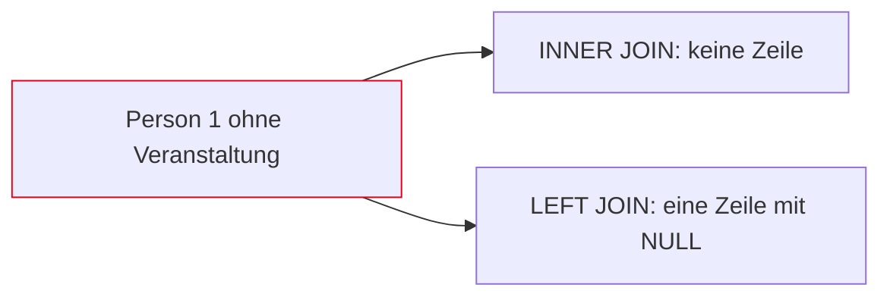
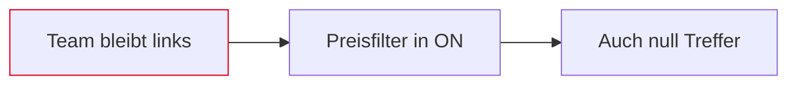
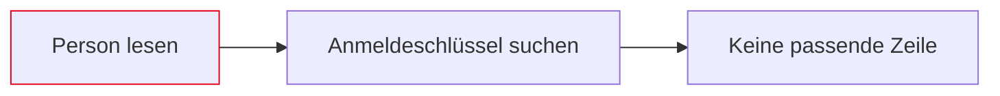
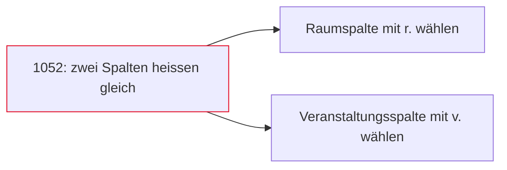
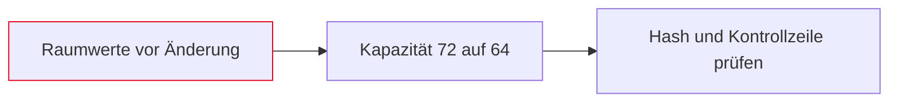

# JOIN und Bestandsprüfung

**Session 07.** Die Einsatzleitung möchte Teammitglieder mit und ohne geplante Veranstaltungen sehen. Bei der Raumliste soll eine unveränderte Zeilenzahl keine falsche Kapazität verdecken.

**Start.** Laden Sie [Session 07 EventStar.sql](Session%2007%20EventStar.sql) in Ihr lokales Workbench-Schema.

### Lernziele

Sie können:

- **Anwenden:** Veranstaltungen verbinden und fehlende Anmeldungen finden.
- **Anwenden:** Genau das betroffene Paar korrigieren und danach nachprüfen.
- **Analysieren:** Die Wirkung eines Filters in ON und WHERE analysieren.
- **Analysieren:** Abweichungen anhand von Sollzahlen und Hash nachweisen.

## Tabellenverbindungen

### JOIN-Arten und Unterabfragen

Nutzen Sie Schlüssel und Kardinalitäten aus [Session 03](../Session%2003/Session%2003%20Theorie.md). Wählen Sie danach, welche Zeilen ohne Treffer bleiben sollen:

| Ausdruck | Ergebnis |
|---|---|
| INNER JOIN | Nur passende Paare. Eine Person ohne zugeordnete Veranstaltung entfällt. |
| LEFT JOIN | Alle linken Zeilen; fehlt rechts ein Treffer, stehen dort NULL-Werte. |
| RIGHT JOIN | Dasselbe mit vertauschten Seiten. |
| CROSS JOIN | Jedes linke Element mit jedem rechten; 4 Räume und 3 Zeitfenster ergeben 12 Kombinationen. |
| Self-JOIN | Dieselbe Tabelle mit zwei Aliasen; etwa die EventStar-Raumtabelle zweimal für einen Vergleich von Raumkapazitäten. Der Join-Typ kann INNER oder LEFT sein. |
| FULL OUTER JOIN | Erhält nicht passende Zeilen beider Seiten. MySQL 8.4 hat dafür keinen direkten Befehl; kombinieren Sie bei Bedarf einen LEFT JOIN mit den noch fehlenden rechten Zeilen per UNION ALL. |

Eine skalare Unterabfrage liefert höchstens einen Wert, etwa die durchschnittliche Raumkapazität. Eine Mengenabfrage kann mehrere Werte für IN liefern. EXISTS prüft nur, ob mindestens eine Zeile entsteht; in einer korrelierten Unterabfrage bezieht sich die innere Bedingung auf die aktuelle äussere Zeile. NOT EXISTS testet, ob die passende Zeile fehlt. Anders als bei NOT IN mit NULL in der Liste gibt es dabei keine mehrdeutige Negation durch UNKNOWN.

**Was prüfe ich?** Verschwinden Teammitglieder ohne Veranstaltung, kontrollieren Sie zuerst den Join-Typ und dann, ob ein WHERE auf einer rechten Spalte die ergänzten NULL-Zeilen ausfiltert.

### Mengenoperationen

JOIN fügt Spalten nebeneinander zusammen. UNION, INTERSECT und EXCEPT vergleichen dagegen Zeilen aus Abfragen mit gleich vielen und kompatiblen Ausgabespalten. UNION vereinigt, INTERSECT liefert die Schnittmenge und EXCEPT nur linke Zeilen ohne Gegenstück. Ohne ALL werden doppelte Ergebniszeilen entfernt. MySQL 8.4 unterstützt alle drei.

Für einen Technikcheck vergleicht EventStar zwei Listen von Raumkapazitäten. Die Schnittmenge zeigt, welche Kapazitäten in beiden Listen vorkommen.

```sql
SELECT 18 AS plaetze UNION SELECT 36 UNION SELECT 72
INTERSECT SELECT 72;
```

INTERSECT bindet stärker als UNION. In diesem Ausdruck filtert es nur den letzten UNION-Zweig; das Ergebnis enthält 18, 36 und 72. Setzen Sie Klammern um die ganze linke Liste, wenn Sie nur 72 erwarten.

### Veranstaltungen und Zuständigkeit

Der Name gehört zur Person, der Titel zur Veranstaltung. Ein JOIN ordnet über die Verantwortlichen-ID den Namen zu, ohne ihn in jeder Veranstaltung zu speichern.

| Team | Veranstaltung | Ausgabe |
| --- | --- | --- |
| 2: Miro Tal | 101: Lichtwerkstatt | Miro Tal: Lichtwerkstatt |
| 1: Lea Fluss | Keine Veranstaltung | Nur mit LEFT JOIN |

**Was prüfe ich?** Entscheiden Sie vor der Abfrage, ob eine Person ohne Veranstaltung in der Ausgabe stehen soll.

### LEFT JOIN

Eine Person ohne zugeordnete Veranstaltung bleibt im LEFT JOIN sichtbar. Vergleichen Sie die Ergebniszeilen mit den tatsächlich zugeordneten Veranstaltungen.




```sql
SELECT m.mitarbeitenden_id, COUNT(*) AS ergebniszeilen,
       COUNT(v.veranstaltungs_id) AS anlaesse
FROM mitarbeitende AS m LEFT JOIN veranstaltungen AS v
  ON v.verantwortlichen_id = m.mitarbeitenden_id
WHERE m.mitarbeitenden_id = 1 GROUP BY m.mitarbeitenden_id;
```

| Team-ID | Zeilen | Anlässe |
| --- | --- | --- |
| 1 | 1 | 0 |

**Was prüfe ich?** Die Platzhalterzeile zählt bei COUNT(*), ihr fehlender Veranstaltungsschlüssel dagegen nicht.

### ON und WHERE

Zählen Sie nur Veranstaltungen ab 40.00, ohne Teammitglieder ohne passenden Anlass auszulassen.



```sql
SELECT m.mitarbeitenden_id, COUNT(v.veranstaltungs_id) AS anlaesse
FROM mitarbeitende AS m LEFT JOIN veranstaltungen AS v
  ON v.verantwortlichen_id = m.mitarbeitenden_id AND v.preis >= 40
WHERE m.mitarbeitenden_id IN (1, 2)
GROUP BY m.mitarbeitenden_id ORDER BY m.mitarbeitenden_id;
```

| Person | Anlässe ab 40.00 |
| --- | --- |
| 1 | 0 |
| 2 | 1 |

**Was prüfe ich?** Ein Preisfilter in WHERE würde Person 1 entfernen, da für sie rechts NULL steht.

## Fehlende und mehrdeutige Treffer

### NOT EXISTS

Suchen Sie Teilnehmende, zu denen keine Anmeldung vorliegt. Die Unterabfrage prüft jede ausgewählte Person einzeln.



```sql
SELECT p.teilnehmenden_id, p.vorname FROM teilnehmende AS p
WHERE NOT EXISTS (SELECT 1 FROM anmeldungen AS a
                  WHERE a.teilnehmenden_id = p.teilnehmenden_id)
ORDER BY p.teilnehmenden_id;
```

| Person | Vorname |
| --- | --- |
| 206 | Ari |
| 207 | Nila |

**Was prüfe ich?** NOT EXISTS reagiert auf das Fehlen einer Zeile, nicht auf einen fehlenden Wert innerhalb einer vorhandenen Zeile.

### Fehler 1052

Raumtabelle und Veranstaltungstabelle besitzen beide eine Spalte raum_id. Ohne Alias bleibt unklar, welche ausgewählt werden soll.

```sql
SELECT raum_id
FROM raeume AS r JOIN veranstaltungen AS v ON v.raum_id = r.raum_id;
```

```text
ERROR 1052: Column 'raum_id' in field list is ambiguous
```



**Was prüfe ich?** Qualifizieren Sie die Spalte im SELECT mit r. oder v. Der Alias benennt den Ursprung eindeutig.

## Bestandsprüfung und Korrektur

### Hash und Korrektur

Die Liste der Raumkapazitäten behält beim Umbau dieselbe Zeilenzahl. Ein Vergleich der sortierten Raum- und Kapazitätswerte zeigt trotzdem eine Änderung.



```sql
START TRANSACTION;
SELECT SHA2(GROUP_CONCAT(CONCAT_WS(':', raum_id, kapazitaet)
    ORDER BY raum_id SEPARATOR ';'), 256) INTO @vorher FROM raeume;
UPDATE raeume SET kapazitaet = 64 WHERE raum_id = 20;
SELECT @vorher = SHA2(GROUP_CONCAT(CONCAT_WS(':', raum_id, kapazitaet)
    ORDER BY raum_id SEPARATOR ';'), 256) AS hash_gleich,
    COUNT(*) AS zeilen FROM raeume;
SELECT raum_id, kapazitaet FROM raeume WHERE raum_id IN (20, 30)
ORDER BY raum_id;
ROLLBACK;
```

| Kontrolle | Resultat |
| --- | --- |
| Hash gleich, Zeilen | 0, 4 |
| Raum 20, Kapazität | 64 |
| Raum 30, Kapazität | 18 |

**Was prüfe ich?** Raum 30 bleibt bei 18 Plätzen. Der Hash belegt, dass mindestens ein einbezogener Wert abweicht; die Zeilenabfrage zeigt, welcher.

### Browser-Übung

Öffnen Sie [DB Fiddle](https://www.db-fiddle.com/) und wählen Sie eine angebotene MySQL-8-Version. Der Editor ist leer. Kopieren Sie das Startschema in «Schema SQL» und die Abfrage in «Query SQL».

<details>
<summary>Startschema für den Browser</summary>

```sql
CREATE TABLE lager (id INT PRIMARY KEY);
CREATE TABLE sendung (id INT, lager_id INT);
INSERT INTO lager VALUES (4),(7);
INSERT INTO sendung VALUES (71,4);
```

</details>

```sql
SELECT l.id, COUNT(s.id) FROM lager AS l LEFT JOIN sendung AS s ON s.lager_id = l.id GROUP BY l.id;
```

### Selbstcheck

<details>
<summary>Wie bleibt eine Person ohne passende Veranstaltung im Ergebnis?</summary>

LEFT JOIN erhält sie links. Der Filter für eine passende Veranstaltung gehört hier in ON.

</details>

<details>
<summary>Was zeigt ein anderer Hash bei derselben Zeilenzahl?</summary>

Mindestens ein in den Hash einbezogener Wert ist anders, wenn Format und Reihenfolge unverändert sind.

</details>

### Transfer

**Basis:** Ergänzen Sie die Schlüssel im JOIN des Arbeitsblatts. **Vertiefung:** Begründen Sie im [Datenkrimi](Session%2007%20Datenkrimi.md), welche zwei Paare abweichen und welcher Protokolleintrag dazu passt.

[Arbeitsblatt zum Ausfüllen](Session%2007%20Arbeitsblatt.docx)

### Freiwillige Übungen

[Übungen zu dieser Session](Session%2007%20%C3%9Cbungen.md).
