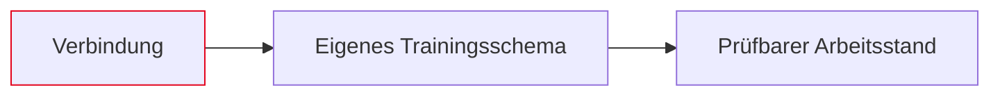
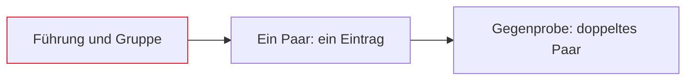
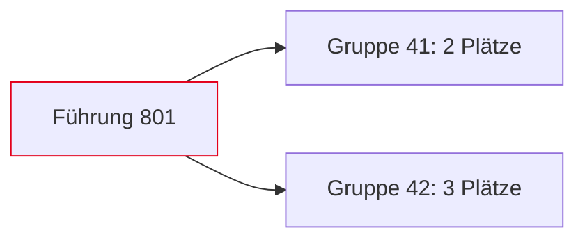
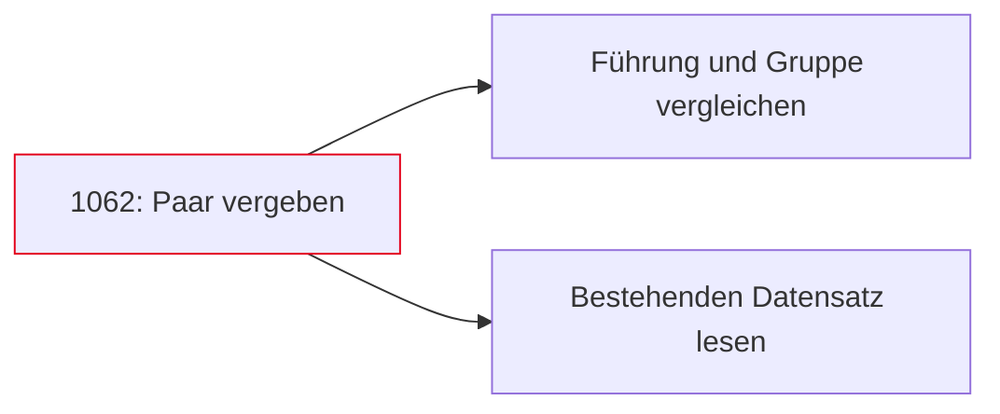
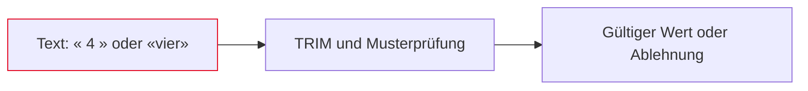
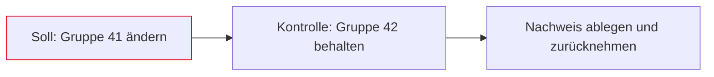

# Gesamtübung

**Session 08.** Sind die Tabellenregeln aktiv, und wurde wirklich nur die gewünschte Zeile geändert? Üben Sie die Nachweise in einem separaten EventStar-Schema.

**Start.** Die Beispiele laufen unabhängig vom Arbeitsblatt in Workbench. Führen Sie den Start des ersten Schritts aus. Vergleichen Sie die Ergebnisse danach mit Ihrer Erwartung.

### Lernziele

Sie können:

- **Verstehen:** Kardinalitäten zwischen Führungen und Gruppen erklären.
- **Anwenden:** Ein Schlüsselpaar umsetzen und mit einem Gegenbeispiel testen.
- **Anwenden:** Dateidaten prüfen, übernehmen und Abweisungen belegen.
- **Beurteilen:** Die eigene Korrektur anhand von Ziel- und Kontrollzeile bewerten.

## Modell und Schlüssel

### Arbeitsstand

Planen Sie pro Teil einen Nachweis. Speichern Sie zuerst nur ein Skript, das im richtigen Schema startet und eine lesbare Versionskontrolle liefert.



```sql
CREATE DATABASE IF NOT EXISTS eventstar_probe_training;
USE eventstar_probe_training;
SELECT VERSION() LIKE '8.4.%' AS kursversion,
       DATABASE() AS schema_name;
```

| Kursversion | Schema |
| --- | --- |
| 1 | eventstar_probe_training |

**Was prüfe ich?** Wenn die Kursversion 0 ergibt, sind Sie auf einem anderen Serverstand. Ziehen Sie daraus noch keinen Schluss über Ihre Tabellen.

### Schlüsselpaar

In dieser Vorbereitung reservieren Gruppen Führungen. Wiederholen Sie die Regel «Eine Gruppe darf dieselbe Führung nur einmal reservieren». Erstellen Sie dazu eine kleine Testtabelle mit zusammengesetztem Schlüssel.





```sql
DROP TABLE IF EXISTS reservierung;
CREATE TABLE reservierung (
    fuehrung_id INT, gruppe_id INT,
    plaetze INT NOT NULL CHECK (plaetze > 0),
    PRIMARY KEY (fuehrung_id, gruppe_id)
);
INSERT INTO reservierung VALUES (801, 41, 2), (801, 42, 3);
SELECT COUNT(*) AS paare FROM reservierung;
```

| Paare |
| --- |
| 2 |

**Was prüfe ich?** Zwei Gruppen dürfen dieselbe Führung reservieren. Das beweist der gültige Fall; der nächste Schritt prüft den Gegenfall.

### Fehler 1062

Führen Sie nur diese Anweisung aus und sichern Sie die Meldung. Eine dokumentierte Gegenprobe zeigt, welche Regel falsche Eingaben abweist.

```sql
INSERT INTO reservierung VALUES (801, 41, 4);
```

```text
ERROR 1062: Duplicate entry '801-41' for key 'reservierung.PRIMARY'
```



**Was prüfe ich?** 1062 meldet das doppelte Paar im Primärschlüssel. Kontrollieren Sie, dass die ursprünglichen zwei Plätze nicht überschrieben wurden.

## Importprüfung

### Rohwerte

Wiederholen Sie die Trennung von Rohwert und geprüfter Zahl. Ein Leerzeichen bedeutet nicht zwingend «leer». Ein Wort ist dagegen keine gültige Platzzahl.



```sql
WITH roh AS (SELECT ' 4 ' AS plaetze UNION ALL SELECT 'vier')
SELECT TRIM(plaetze) AS wert,
       TRIM(plaetze) REGEXP '^[0-9]+$' AS ziffern
FROM roh ORDER BY ziffern DESC;
```

| Wert | Ziffern |
| --- | --- |
| 4 | 1 |
| vier | 0 |

**Was prüfe ich?** Die Musterprüfung sichert nur die Schreibweise. Gültige Mengen brauchen zusätzlich einen passenden Wertebereich.

## Korrektur und Nachweis

### Korrekturbeleg

Wiederholen Sie den Nachweis der Änderung aus Session 07. Eine Gruppe bekommt mehr Plätze; die andere bleibt unverändert. Der Versuch wird zurückgenommen.



```sql
START TRANSACTION;
UPDATE reservierung SET plaetze = 4 WHERE fuehrung_id = 801 AND gruppe_id = 41;
SELECT gruppe_id, plaetze FROM reservierung ORDER BY gruppe_id;
ROLLBACK;
```

| Gruppe | Plätze |
| --- | --- |
| 41 | 4 |
| 42 | 3 |

**Was prüfe ich?** Eine gleichbleibende Zeilenzahl allein könnte auch eine irrtümliche Änderung der anderen Gruppe verdecken. Im Probelauf brauchen Sie die Werte vor und nach der Korrektur.

### Browser-Übung

Öffnen Sie [DB Fiddle](https://www.db-fiddle.com/) und wählen Sie eine angebotene MySQL-8-Version. Der Editor ist leer. Kopieren Sie das Startschema in «Schema SQL» und die Abfrage in «Query SQL».

<details>
<summary>Startschema für den Browser</summary>

```sql
CREATE TABLE reservierung (f INT, g INT, plaetze INT, PRIMARY KEY(f,g));
INSERT INTO reservierung VALUES (801,41,2),(801,42,3);
```

</details>

```sql
SELECT g, plaetze FROM reservierung ORDER BY g;
```

### Selbstcheck

<details>
<summary>Was halten Sie bei einem erwarteten Fehler fest?</summary>

Befehl, Fehlernummer und verletzte Regel. Danach kontrollieren Sie den unveränderten Bestand.

</details>

<details>
<summary>Wann wechseln Sie zum nächsten Arbeitsschritt?</summary>

Sobald ein ausführbarer Zwischenstand und ein Nachweis vorliegen; offene Details können Sie markieren und später klären.

</details>

### Transfer

**Basis:** Planen Sie die Nachweise vor dem Start. **Vertiefung:** Notieren Sie nach der Gesamtübung, welchen Nachweis Sie beim nächsten Mal früher sichern.

[Arbeitsblatt zum Ausfüllen](Session%2008%20Arbeitsblatt.docx)

### Freiwillige Übungen

[Übungen zu dieser Session](Session%2008%20%C3%9Cbungen.md).
