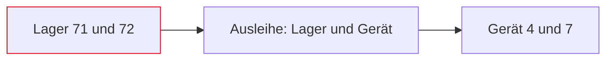
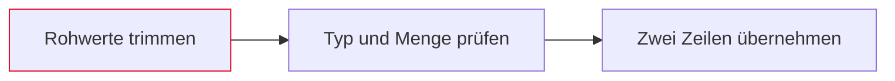
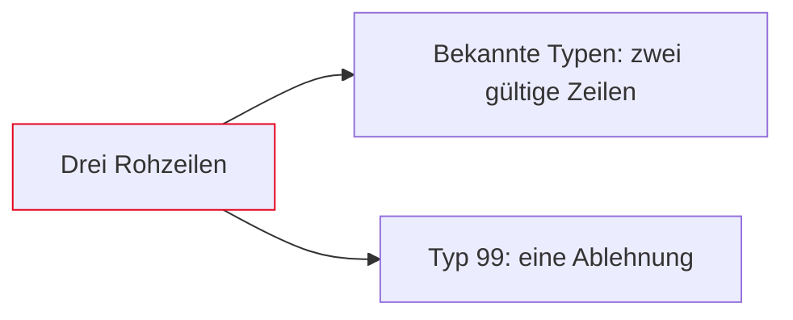
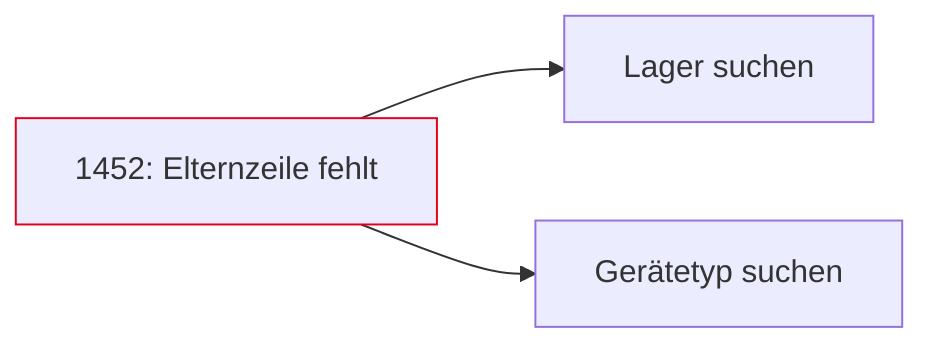
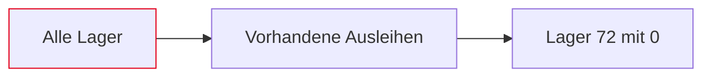
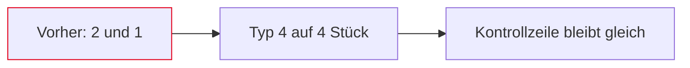

# Repetition

**Session 09.** EventStar plant den Einsatz von Leihgeräten pro Lager. Nach der Übernahme erhält ein Lager mehr Funkgeräte. Import und Korrektur brauchen je einen eigenen Nachweis.

**Start.** Verwenden Sie das getrennte Übungsschema aus dem ersten SQL-Block. Führen Sie die SQL-Blöcke der Reihe nach aus, den Fehlerfall einzeln.

### Lernziele

Sie können:

- **Anwenden:** Schlüsselpaar, Wertregeln und Löschaktion umsetzen.
- **Anwenden:** Textrohdaten prüfen und nur gültige Einsätze übernehmen.
- **Anwenden:** Kennzahlen auch für Anlässe ohne Einsätze ausgeben.
- **Analysieren:** Ziel- und Kontrollzeile vor und nach der Korrektur vergleichen.
- **Erschaffen:** Eine Zwischentabelle für Helfereinsätze entwerfen.

## Modellierung

### Einsatzmodell

Die Ausleihe hat einen Lager- und einen Geräteschlüssel. Pro Paar sind ein bis sechs Geräte erlaubt. Zum Lager 72 liegt noch keine Ausleihe vor.



```sql
CREATE DATABASE IF NOT EXISTS eventstar_09_training;
USE eventstar_09_training;
DROP TABLE IF EXISTS ausleihe, lager, leihtyp;
CREATE TABLE lager (id INT PRIMARY KEY);
CREATE TABLE leihtyp (id INT PRIMARY KEY);
CREATE TABLE ausleihe (
    lager_id INT, typ_id INT, stueck INT NOT NULL CHECK (stueck BETWEEN 1 AND 6),
    PRIMARY KEY (lager_id, typ_id),
    FOREIGN KEY (lager_id) REFERENCES lager(id),
    FOREIGN KEY (typ_id) REFERENCES leihtyp(id)
);
INSERT INTO lager VALUES (71), (72);
INSERT INTO leihtyp VALUES (4), (7);
SELECT id FROM lager ORDER BY id;
```

| Lager |
| --- |
| 71 |
| 72 |

**Was prüfe ich?** Ein Lager darf mehrere Gerätetypen ausleihen. Nur das vollständige Paar bezeichnet eine Zeile.

## Import und Integrität

### Datenübernahme

Das Rohfeld enthält die Menge als Text. Zwei Zeilen erfüllen sowohl die Verweis- als auch die Mengenregel. Die dritte nennt einen Gerätetyp, den es nicht gibt.





```sql
INSERT INTO ausleihe (lager_id, typ_id, stueck)
WITH roh AS (
    SELECT 71 AS lager_nr, 4 AS typ_nr, ' 2 ' AS menge UNION ALL
    SELECT 71, 7, '1' UNION ALL SELECT 71, 99, '3'
)
SELECT l.id, t.id, CAST(TRIM(r.menge) AS UNSIGNED)
FROM roh AS r JOIN lager AS l ON l.id = r.lager_nr
JOIN leihtyp AS t ON t.id = r.typ_nr
WHERE TRIM(r.menge) REGEXP '^[1-6]$';
SELECT ROW_COUNT() AS uebernommen;
```

| Übernommen |
| --- |
| 2 |

**Was prüfe ich?** Dieses Beispiel hat keine Dubletten. Prüfen Sie bei Dateiimporten auch doppelte Paare. Typ 99 scheitert am zweiten JOIN, nicht an der Mengenregel.

### Fehler 1452

Versuchen Sie ohne Vorprüfung, Gerätetyp 99 an Lager 71 auszuleihen.

```sql
INSERT INTO ausleihe VALUES (71, 99, 3);
```

```text
ERROR 1452: Cannot add or update a child row: a foreign key constraint fails
```



**Was prüfe ich?** 1452 bezeichnet die fehlende Elternzeile. Das Lager ist vorhanden; der Gerätetyp fehlt.

## Kennzahlen

### Auswertung

Die Übersicht beginnt bei allen Lagern. Zählen Sie nur verknüpfte Gerätetypen und weisen Sie für ein leeres Lager eine Stückzahl von 0 aus.



```sql
SELECT l.id, COUNT(a.typ_id) AS typen,
       COALESCE(SUM(a.stueck), 0) AS stueck
FROM lager AS l LEFT JOIN ausleihe AS a ON a.lager_id = l.id
GROUP BY l.id ORDER BY l.id;
```

| Lager | Typen | Stück |
| --- | --- | --- |
| 71 | 2 | 3 |
| 72 | 0 | 0 |

**Was prüfe ich?** COUNT(*) zählt bei Lager 72 auch die Platzhalterzeile. COUNT(a.typ_id) zählt dort 0.

## Gezielte Korrektur

### Ziel- und Kontrollzeile

EventStar braucht zwei zusätzliche Geräte von Typ 4. Vergleichen Sie beide Ausleihen von Lager 71 und nehmen Sie den Versuch zurück.



```sql
START TRANSACTION;
UPDATE ausleihe SET stueck = 4 WHERE lager_id = 71 AND typ_id = 4;
SELECT typ_id, stueck FROM ausleihe WHERE lager_id = 71 ORDER BY typ_id;
ROLLBACK;
```

| Typ | Stück |
| --- | --- |
| 4 | 4 |
| 7 | 1 |

**Was prüfe ich?** Vergleichen Sie mit dem Import. Die Summe steigt von 3 auf 5, aber erst der zeilenweise Vergleich belegt, dass Typ 7 unverändert blieb.

### Browser-Übung

Öffnen Sie [DB Fiddle](https://www.db-fiddle.com/) und wählen Sie eine angebotene MySQL-8-Version. Der Editor ist leer. Kopieren Sie das Startschema in «Schema SQL» und die Abfrage in «Query SQL».

<details>
<summary>Startschema für den Browser</summary>

```sql
CREATE TABLE lager (id INT PRIMARY KEY);
CREATE TABLE ausleihe (lager_id INT, typ_id INT, stueck INT, PRIMARY KEY(lager_id, typ_id));
INSERT INTO lager VALUES (71),(72);
INSERT INTO ausleihe VALUES (71,4,2),(71,7,1);
```

</details>

```sql
SELECT l.id, COUNT(a.typ_id), COALESCE(SUM(a.stueck),0) FROM lager AS l LEFT JOIN ausleihe AS a ON a.lager_id = l.id GROUP BY l.id;
```

### Selbstcheck

<details>
<summary>Warum wurde Typ 99 nicht übernommen?</summary>

Der Geräteverweis löst sich nicht auf. Die Mengenangabe wäre für sich gültig.

</details>

<details>
<summary>Woran sehen Sie, dass die richtige Ausleihe korrigiert wurde?</summary>

Typ 4 hat danach vier Stück, Typ 7 weiterhin eines.

</details>

### Transfer

**Basis:** Ordnen Sie im Arbeitsblatt Modell, Übernahme und Kontrolle den drei Arbeitsschritten zu. **Vertiefung:** Prüfen Sie zu zweit, ob die Korrektur genau eine Zeile änderte und ob das Protokoll eine unbeabsichtigte Änderung sichtbar machen würde.

[Arbeitsblatt zum Ausfüllen](Session%2009%20Arbeitsblatt.docx)

### Freiwillige Übungen

[Übungen zu dieser Session](Session%2009%20%C3%9Cbungen.md).
